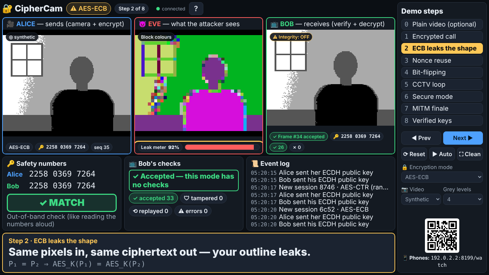

# 🔐 CipherCam

**A live encrypted video call in your browser, built to show that *how* you use AES matters more than AES itself.**

**Alice** sends video, **Bob** receives it, and **Eve** is the attacker sitting in the relay, like a hacked Wi-Fi router.
The demo shows five classic mistakes and the fix for each, live on a projector:

| # | Attack | What the audience sees | Fix |
|---|---|---|---|
| 1 | ECB pattern leak | Eve sees your outline without the key | Randomized mode (CBC/CTR, fresh IV) |
| 2 | CTR nonce reuse | Eve recovers the keystream and watches the call | Unique nonce for every frame |
| 3 | Bit-flipping | Eve stamps a ★ onto Bob's video | MAC: HMAC-SHA256 or AES-GCM |
| 4 | Replay ("CCTV loop") | Bob still sees you after you left the room | Frame counter covered by the MAC |
| 5 | Key-exchange MITM | Eve decrypts everything, even AES-GCM | Safety-number check |



*EC 425 Cryptography and Network Security, NIT Warangal. Aravapalli Sai Chaithr Choudary (23ECB0A20). Instructor: Dr. Sourabh Solanki.*

---

## Quick start — Windows

1. Install **Node.js LTS** from [nodejs.org](https://nodejs.org) (accept all defaults).
2. Download this project as a ZIP — the finished version is on the branch **`claude/keen-gates-2y13h1`**:
   `https://github.com/chaithr45/CNS_PROJECT/archive/refs/heads/claude/keen-gates-2y13h1.zip`
   (or on GitHub pick that branch, then **Code → Download ZIP**). **Right-click → Extract All**, and open the extracted folder.
3. Double-click **`start-demo.bat`**. (The first start installs CipherCam, about 1 minute, needs internet once.)
4. **Chrome or Edge opens the Stage** at `http://localhost:8080/stage`. Click the yellow caption bar, press **R**, then use the **→** key to walk through the demo. Everything (mode, webcam/synthetic video, grey levels, attacks) is controlled from the Stage.

Keep the black server window open while you present. Close it (or press Ctrl+C in it) to stop.

## Quick start — macOS

1. Install **Node.js LTS** from [nodejs.org](https://nodejs.org).
2. Download and unzip the project (or `git clone` it).
3. Double-click **`start-demo.command`**. If macOS blocks it the first time: right-click → **Open** → **Open**.
   (Or in Terminal: `cd` into the folder and run `npm install`, then `npm run demo`.)
4. Your browser opens the Stage. Chrome is recommended.

Linux: `./start-demo.sh`.

After the first `npm install`, **everything works offline**: no CDN, no web fonts, no internet calls.

---

## Testing it yourself

New to all this? **[docs/HOW_TO_TEST.md](docs/HOW_TO_TEST.md)** walks you through installing, starting, and testing every screen, all five attacks and secure mode, click by click, with pictures and a troubleshooting table.

## Giving the demo

Read **[docs/DEMO_GUIDE.md](docs/DEMO_GUIDE.md)**: setup, checklists, what to press and what to say for every step, timing, camera tuning and a recovery playbook. Print **[docs/DEMO_CHEATSHEET.md](docs/DEMO_CHEATSHEET.md)**.

Stage keys: **→ / ←** next/previous step · **0–8** jump · **R** reset · **A** auto-play · **F** clean view · **?** help.

Plan B: **`docs/backup-demo.mp4`** (and `.webm`) is a recording of the whole auto-played demo with captions.

---

## Commands

| Command | What it does |
|---|---|
| `npm run demo` | Start the server and open the Stage in your browser |
| `npm start` | Start the server without opening a browser (`--no-open`) |
| `npm test` | 54 unit + integration tests (Node's test runner, no browser), including an independent OpenSSL re-check of all five attacks |
| `npm run e2e` | End-to-end tests in Chromium (Playwright): every demo step, both resolutions, screenshots |
| `npm run bench` | Speed / overhead / leak / reject-rate per mode → `docs/results/` |
| `npm run soak` | 10-minute auto-play reliability test → `docs/results/SOAK.md` |
| `npm run video` | Re-record the backup video → `docs/backup-demo.webm` / `.mp4` |
| `npm run vectors` | Regenerate the known-answer vectors in `test/vectors.json` with OpenSSL |
| `npm run build:solo` | Build the optional static solo-mode site into `dist-solo/` |

Server options: `node server/index.js --port 9000 --no-open --allow-remote-control`. The default port is 8080; if it is busy, 8081–8090 are tried and the one used is printed.

`npm run e2e` needs Playwright's Chromium once: `npx playwright install chromium`.

## Pages

| URL | What it is |
|---|---|
| `/` | Start page: links, QR code for phones |
| `/stage` | **The projector view**: Alice, Eve and Bob side by side, demo steps, captions |
| `/alice` | Sender: video source, mode, picture settings, safety number |
| `/bob` | Receiver: video, alerts, counters, stats CSV |
| `/eve` | Attacker: four views, leak meter, bit-flip / replay / MITM controls |
| `/watch` | Read-only phone view of Eve's screen (works over plain `http://<laptop-ip>:8080`) |
| `/selftest` | Known-answer tests of every primitive in this browser |
| `/solo` | Optional solo mode: the whole demo in one page, no relay (see below) |

`/alice` and `/bob` are not needed during the demo — the Stage embeds them. Only the presenter laptop (`localhost`) can change anything. Phones can only watch.

## Solo mode (optional, for sharing a link)

Solo mode runs Alice, an in-memory relay with Eve's attacks, and Bob **in one browser page, with no server**, using exactly the same `shared/` modules and `server/eve-active.js` as the classroom version. Try it locally at `http://localhost:8080/solo` (same keys as the Stage).

To put it online so anyone can try it over HTTPS:

1. `npm run build:solo` → a static site in `dist-solo/` (relative paths, works in a sub-folder).
2. Upload `dist-solo/` to **GitHub Pages** (e.g. push it to a `gh-pages` branch, or Settings → Pages → deploy from a folder), **Vercel** (`vercel deploy dist-solo`), Netlify or any static host. It must be served over **HTTPS** (Web Crypto and the camera need a secure context); GitHub Pages and Vercel do that automatically.

For the classroom, use the Stage: it shows the real network relay, the audience `/watch` page and the event log.

---

## How it works (short)

- Video: 160×120 grayscale, 10 fps (~190 KB/s). Each frame is averaged, smoothed, posterized to 4 grey levels and cut into **4×4 tiles, so one AES block = one square of the picture**.
- Crypto: the browser's **Web Crypto API** (AES-CBC, AES-CTR, AES-GCM, HMAC-SHA256, ECDH P-256, HKDF), plus `aes-js` for AES-ECB, which Web Crypto deliberately omits.
- Keys: a fresh **ECDH P-256** key exchange for every session, then **HKDF-SHA256** → AES key, HMAC key and GCM nonce salt. **Safety number** = SHA-256 of both public keys, 12 digits.
- Network: a **Node.js WebSocket relay**. Eve's active attacks (bit-flip, replay, MITM) run inside it; her passive views run in the browser.

## Documentation

| Document | For |
|---|---|
| [docs/HOW_TO_TEST.md](docs/HOW_TO_TEST.md) | **Start here if you are new:** click-by-click guide to starting and testing everything |
| [docs/DEMO_GUIDE.md](docs/DEMO_GUIDE.md) | Giving the live demo, step by step |
| [docs/DEMO_CHEATSHEET.md](docs/DEMO_CHEATSHEET.md) | One printable page |
| [docs/EXPLAINED.md](docs/EXPLAINED.md) | Every concept in plain English, with pointers to the code |
| [docs/VIVA_QA.md](docs/VIVA_QA.md) | 45 likely viva questions with answers |
| [docs/ARCHITECTURE.md](docs/ARCHITECTURE.md) | Components, message formats, sequence diagrams, state model |
| [docs/REPORT_DRAFT.md](docs/REPORT_DRAFT.md) | Project report draft |
| [docs/results/RESULTS.md](docs/results/RESULTS.md) | Benchmark results |
| [docs/SPEC.md](docs/SPEC.md) | The original build brief |
| [PROGRESS.md](PROGRESS.md) | Build log, decisions and test evidence |

## Folder map

```
start-demo.bat / .command / .sh   double-click starters (Windows / macOS / Linux)
server/      Node relay: index.js (CLI), app.js (HTTP + WebSocket + state), eve-active.js (attacks)
shared/      Code used by BOTH browser and Node: frame.js, crypto.js, ecb.js, protocol.js,
             sender.js, receiver.js, stamps.js, steps.js
public/      Pages (*.html), browser scripts (js/), styles (css/)
solo/        build.js: builds the optional static solo-mode site (dist-solo/)
test/        node:test unit + integration tests, OpenSSL test vectors
e2e/         Playwright end-to-end tests, soak test, backup-video recorder
bench/       Benchmark
docs/        Guides, report draft, screenshots, results, backup video
```

## Requirements

Node.js 20 or newer (22 LTS recommended). Chrome or Edge (Firefox works too). A webcam is optional: the built-in synthetic scene shows every attack.
