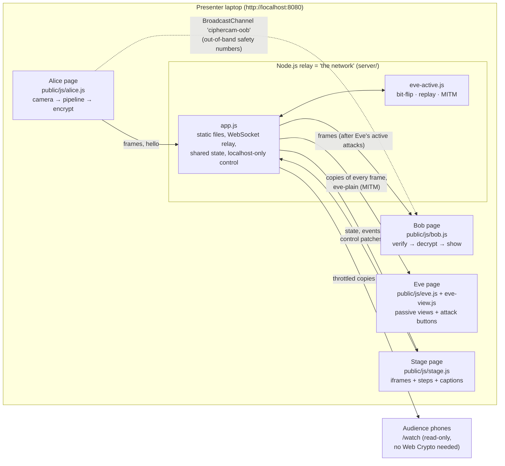
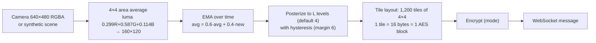
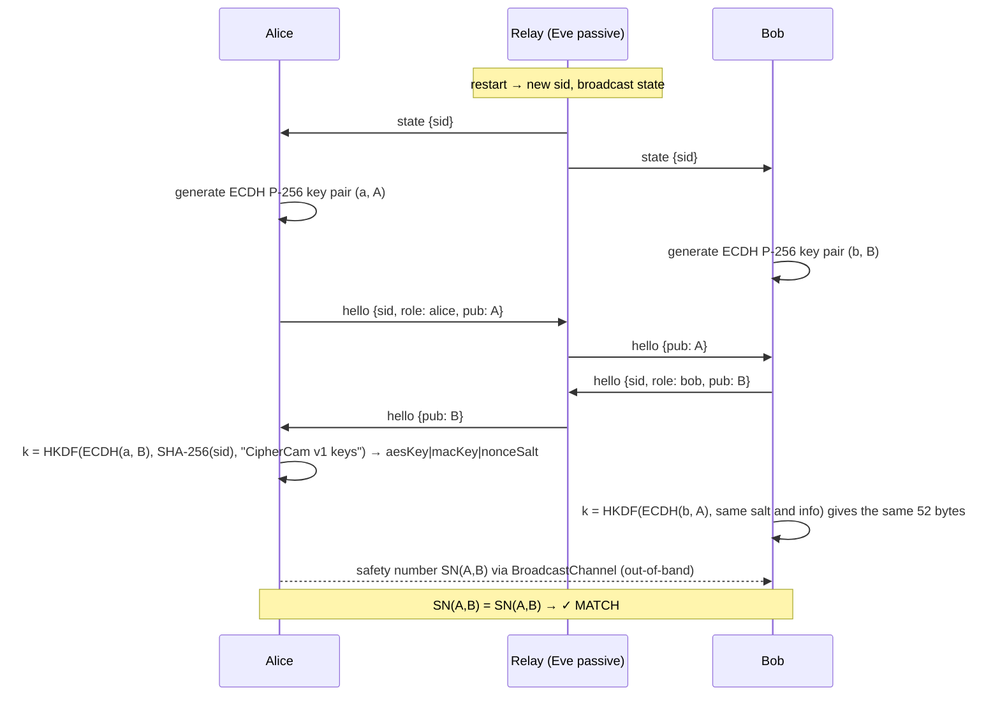
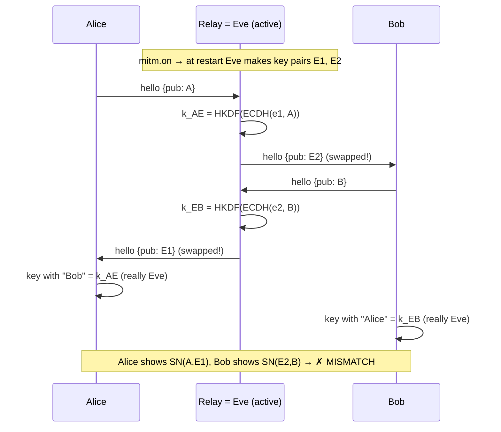
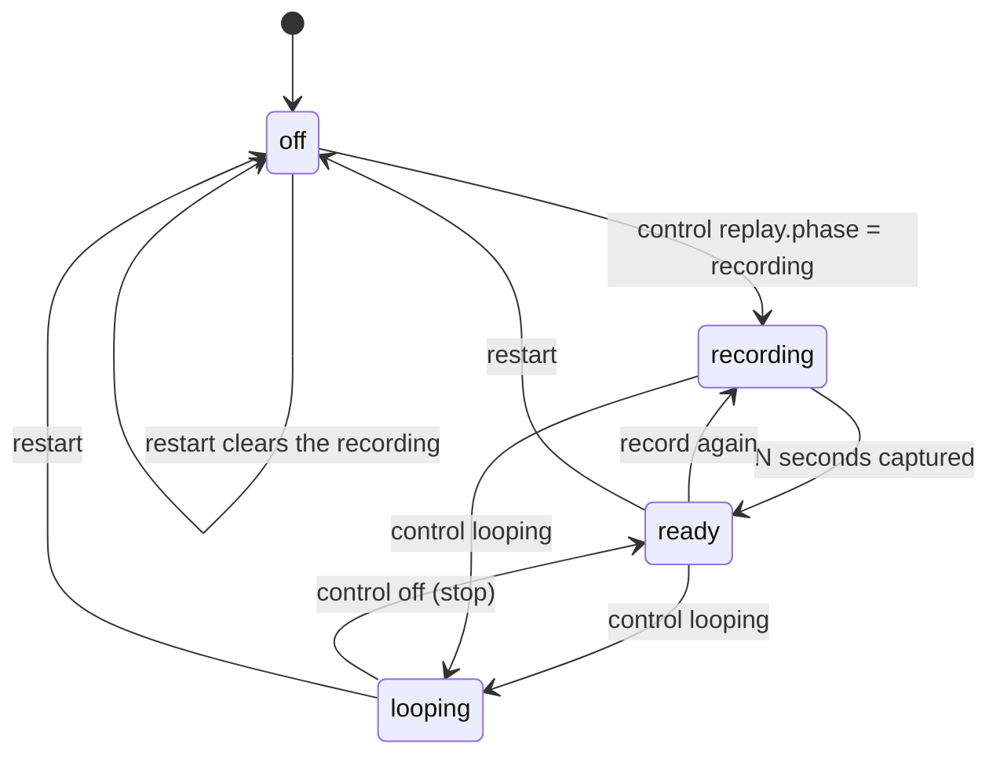

# CipherCam — Architecture

## 1. Components



| Part | Files | Runs in |
|---|---|---|
| Shared core (used by everyone) | `shared/frame.js`, `crypto.js`, `ecb.js`, `protocol.js`, `sender.js`, `receiver.js`, `stamps.js`, `steps.js` | Browser **and** Node |
| Relay server | `server/index.js` (CLI, banner, opens browser), `server/app.js` (HTTP + WebSocket + state), `server/eve-active.js` (active attacks) | Node |
| Pages | `public/*.html`, `public/js/*.js`, `public/css/*.css` | Browser |
| Tests | `test/*.test.js` (node:test), `e2e/*.spec.js` (Playwright), `e2e/soak.js`, `bench/bench.js` | Node / Chromium |

Design rules: vanilla ES modules, no build step, no framework, no CDN. `shared/` touches no browser-only or Node-only global at import time; `crypto.subtle` is looked up only when a function runs. ECB's `aes-js` is injected with `setAesJs()`.

## 2. Video pipeline (Alice)



The first 10 frames (`seq` 0–9) of every session are the fixed splash test card (`makeSplashFrame`) instead of the camera picture.

## 3. Wire format

Every WebSocket message is binary:

```
┌──────────────────────┬──────────────────────────┬───────────────────────┐
│ u32 BE header length │ header: JSON text, UTF-8 │ payload: raw bytes     │
└──────────────────────┴──────────────────────────┴───────────────────────┘
```

For frames, the header bytes are exactly what `ctr-hmac` and `gcm` authenticate. Bob uses the bytes he received, never re-serialized JSON.

| `t` | Direction | Header fields | Payload |
|---|---|---|---|
| `frame` | Alice → relay → Bob, Eve, watchers | `sid, seq, mode, iv (base64/null), w:160, h:120, levels, ts` | `ciphertext ‖ tag` (19,200 B + 0/16/32; CBC +16 padding) |
| `hello` | Alice ↔ Bob via relay | `sid, role, pub` (base64 of the 65-byte raw P-256 key) | — |
| `state` | relay → everyone | `state` (see §6) | — |
| `control` | local client → relay | `patch` (validated by `sanitizePatch`) | — |
| `restart` | local client → relay | — | — |
| `peer-joined` | relay → Alice/Bob | `role` | — |
| `event` | relay → Stage, Eve (Bob → relay for his alerts) | `text, level, ts` | — |
| `eve-plain` | relay → Eve, watchers (MITM only) | `sid, seq, mode, ts` | 19,200 B plaintext, row-major |
| `error` | relay → client | `code` (`forbidden`, `replaced`), `text` | — |

Per-mode payload and checks:

| Mode | IV/nonce | Payload | Bob checks |
|---|---|---|---|
| `plain` | — | 19,200 | none |
| `ecb` | — | 19,200 | none |
| `cbc` | random 16 B | 19,216 (PKCS#7 block) | none |
| `ctr` | random 16 B | 19,200 | none |
| `ctr-reuse` | same 16 B all session | 19,200 | none |
| `ctr-hmac` | random 16 B | 19,200 + 32 (HMAC-SHA256 over header ‖ ciphertext) | tag, then `seq > lastSeq` |
| `gcm` | `nonceSalt(4) ‖ seq(8)` | 19,200 + 16 (tag; AAD = header) | tag, then `seq > lastSeq` |

## 4. Handshake

### Normal



### MITM



## 5. Frame flow through the relay

```mermaid
sequenceDiagram
  participant A as Alice
  participant R as Relay (server/app.js handleFrame)
  participant X as eve-active.js
  participant E as Eve page / watchers
  participant B as Bob
  A->>R: frame (header, payload)
  R->>R: drop if sid ≠ current session
  R->>E: copy of the original frame (watchers throttled, seq 0 always sent)
  alt MITM active
    R->>X: transform: receiveFrame(k_AE, no checks) → pixels
    X-->>E: eve-plain (pixels)
    X->>R: buildFrame(k_EB, same mode, same seq)
  end
  alt replay recording
    R->>X: store (header, payload, t)
  end
  alt replay looping
    X->>B: old frames at the original timing (live frames dropped)
  else live
    R->>R: bit-flip on? payload[i] ^= mask[i] (never the tag; CBC: not the last 32 B)
    R->>B: frame
  end
  B->>B: receiveFrame: parse header → tag check → decrypt → seq > lastSeq?
```

## 6. State model

The relay owns one `state` object (`server/app.js` → `initialState`) and broadcasts it to every client after every change. Clients send `control` patches; only clients on `127.0.0.1`/`::1` may (unless `--allow-remote-control`).

```js
{
  v, sid,                         // version counter, current session id
  mode,                           // 'plain' | 'ecb' | 'cbc' | 'ctr' | 'ctr-reuse' | 'ctr-hmac' | 'gcm'
  levels, fps, margin,            // picture settings
  source, away, wave,             // 'synthetic' | 'webcam'; synthetic person leaves / waves
  eveView, leakHighlight,         // 'raw' | 'blocks' | 'xor' | 'keystream'
  attacks: {
    bitflip: { on, stamp },       // 'star' | 'hacked' | 'smiley'
    replay:  { phase, seconds, recorded },   // 'off' | 'recording' | 'ready' | 'looping'
    mitm:    { on },
  },
  mitmActive,                     // Eve really is in the middle of THIS session
  step, autoplay, overlay,        // demo step 0–8, auto-play flag, big countdown text
  watchFps,                       // frame rate for /watch phones (default 4)
  peers: { alice, bob }, watchers,
}
```



**Session restarts** (new `sid`, new keys, `seq` = 0, 10 splash frames) happen on: a mode change, the Restart button, Alice or Bob (re)connecting, a MITM toggle, and every demo step.

**Roles and limits:** one Alice and one Bob (a newer connection replaces the older one with close code 4000); non-local clients may only be `watch` (4003 otherwise); at most 40 watchers (4029); each watcher gets at most `watchFps` frames per second, and frames are dropped for any slow client (`bufferedAmount`).

## 7. Debug hooks

Every page exposes `window.__ciphercam` (the Stage aggregates Alice, Eve and Bob from its iframes): current step, counters, Bob's last status, the leak meter, the safety numbers and whether they match. The e2e tests assert through these.
