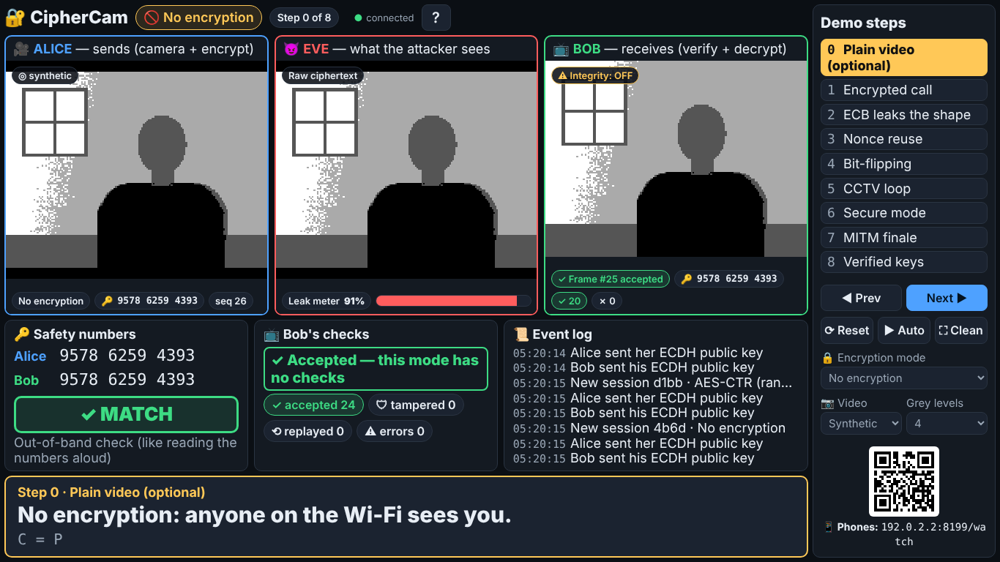
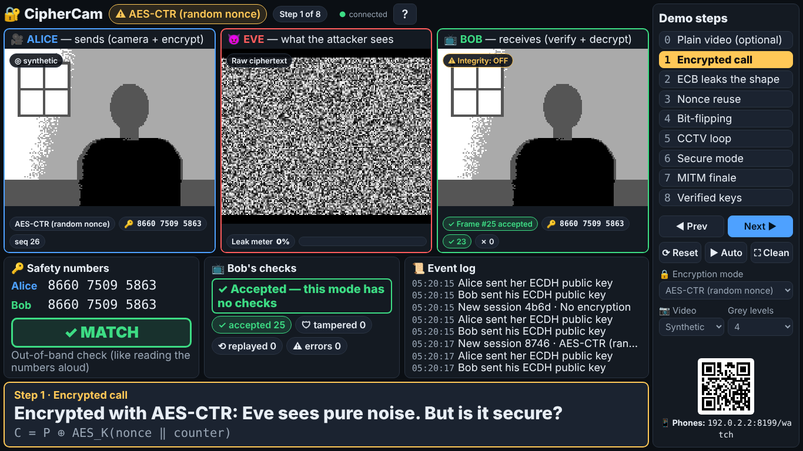
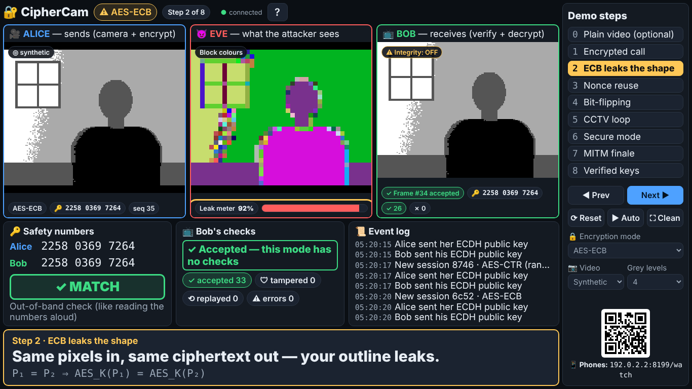
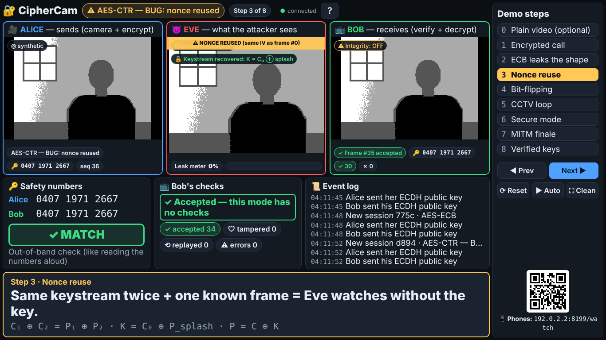
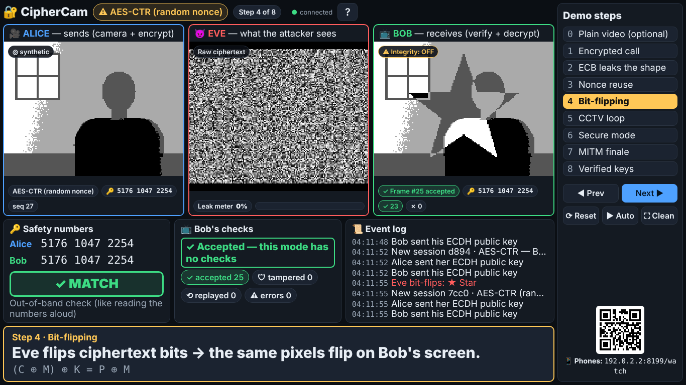
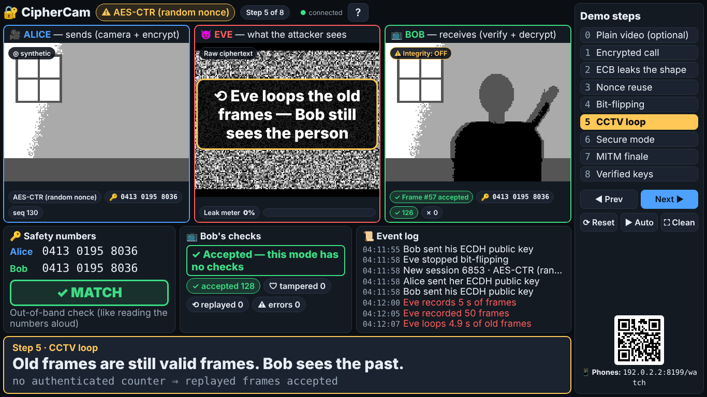
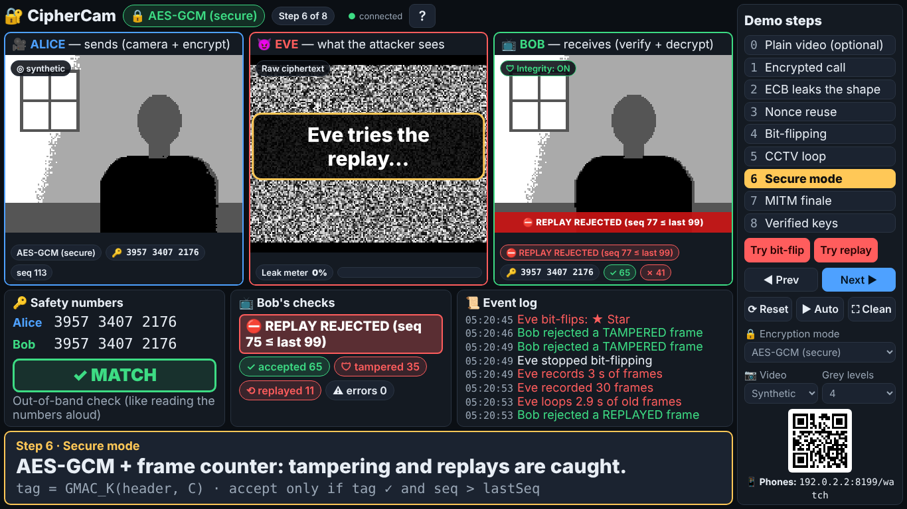
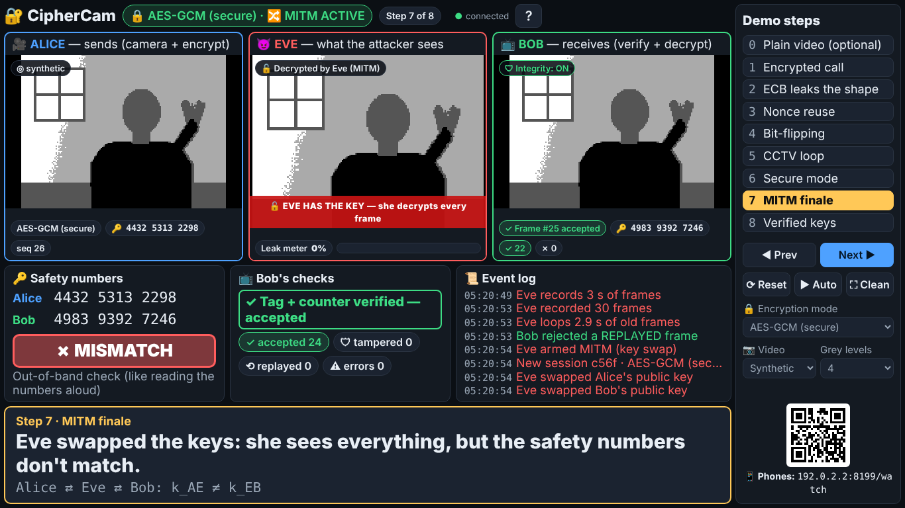
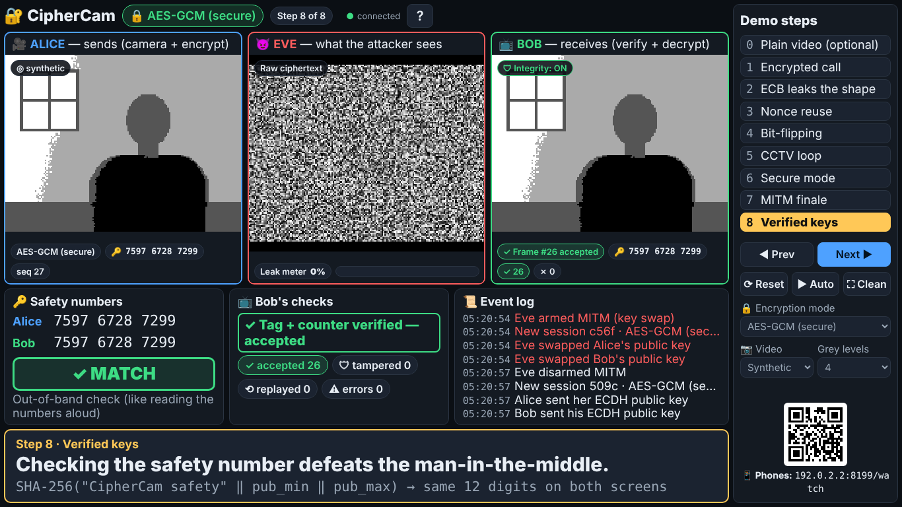

# CipherCam — Live Demo Guide

This is your script for the classroom demo. Follow it top to bottom and you can't get lost.
Total talking time: **about 7 minutes.** Print [`DEMO_CHEATSHEET.md`](DEMO_CHEATSHEET.md) and keep it next to the laptop.

---

## 1. What you need

- Your **laptop** and its **charger** (plug it in: video + crypto uses battery).
- An **HDMI adapter** for the projector (check your laptop's port: HDMI, USB-C or mini-DP).
- **Chrome or Edge** (already on Windows).
- Optional: a **phone hotspot** or Windows Mobile Hotspot, only if you want audience phones to watch along.
- Optional: the backup video `docs/backup-demo.mp4` (or `.webm`), copied to the desktop.

Nothing needs the internet once `npm install` has run.

---

## 2. Setup

### (A) Recommended: laptop + projector only

```
 ┌──────────────── your laptop ────────────────┐        HDMI       ┌───────────┐
 │  CipherCam server (node)                     │ ────────────────► │ projector │
 │  Chrome/Edge: http://localhost:8080/stage    │                   └───────────┘
 │    ├─ Alice panel (camera)                   │
 │    ├─ Eve panel  (attacker view)             │
 │    └─ Bob panel  (received video)            │
 └──────────────────────────────────────────────┘
```

Everything runs on `localhost`. No Wi-Fi needed. This is the safest option.

1. Double-click **`start-demo.bat`** (in the CipherCam folder).
2. A black window opens and prints `CipherCam is running`. **Don't close it.** It is the "network".
3. Chrome/Edge opens the **Stage** at `http://localhost:8080/stage`.
4. Press **F11** for full screen.

### (B) Optional bonus: audience phones on `/watch`

```
 ┌──────── laptop (Mobile Hotspot ON) ────────┐  Wi-Fi  ┌──────────────┐
 │ CipherCam server                           │◄────────│ phones:       │
 │ Stage on projector                         │         │ http://IP:8080│
 └────────────────────────────────────────────┘         │  /watch       │
                                                        └──────────────┘
```

1. **Best:** turn on **Windows Mobile Hotspot** (Settings → Network & internet → Mobile hotspot) and let the phones join it. Otherwise, the laptop and the phones join the **same** phone hotspot.
2. The first time Node starts, Windows asks about the **firewall**. Tick **Private networks** and click **Allow**.
   (If you missed it: Windows Security → Firewall → "Allow an app through firewall" → Node.js → tick Private.)
3. Phones scan the **QR code** at the bottom-right of the Stage (or on the start page `http://localhost:8080/`). They see Eve's view and the caption, read-only.
4. **College Wi-Fi often blocks phone-to-laptop traffic** ("client isolation"). Don't rely on it. If phones can't connect, skip this. The demo doesn't need it.

Phones can never control anything. Only the laptop can.

---

## 3. Checklists

### The night before

- [ ] `git pull` (or download the latest ZIP), then double-click `start-demo.bat` once.
- [ ] Open a terminal in the folder and run `npm test`. It should end with `# fail 0`.
- [ ] On the Stage, press **A** (auto-play) and watch the whole demo once (~2 minutes). Press **A** again to stop.
- [ ] Rehearse once **by hand** with the arrow keys, saying the "Say" lines below out loud.
- [ ] Try your **webcam** (Alice panel → open `http://localhost:8080/alice` → Video source: Webcam) and tune it (section 7).
- [ ] Copy `docs/backup-demo.mp4` (or `.webm`) to the desktop. Check it plays.
- [ ] Charge the laptop.

### 30 minutes before

- [ ] Plug in the charger. Close heavy apps (Teams, games, other browser tabs, OneDrive sync).
- [ ] Connect the projector. Windows key + **P** → **Duplicate** (simplest: you see what they see).
- [ ] Start `start-demo.bat`. The Stage opens.
- [ ] Browser zoom at **100%** (Ctrl + 0).
- [ ] If you'll use the webcam: allow camera permission when the browser asks.
- [ ] Lighting: light on your face, **plain light wall behind you**. A **dark shirt** makes the ECB outline much clearer.
- [ ] Press **R** (reset). You should see **✓ MATCH** under Safety numbers and Bob's video moving.

### 5 minutes before

- [ ] F11 for full screen. Press **R** once more.
- [ ] Click once on the dark background of the Stage so the keyboard goes to it.
- [ ] Backup video open in another window, minimised.
- [ ] Phone on silent.

---

## 4. The keys

| Key | What it does |
|---|---|
| **→** / **←** | Next / previous step |
| **0**–**8** | Jump straight to that step |
| **R** | Reset everything: step 1, all attacks off, fresh keys |
| **A** | Auto-play the whole demo with captions (press again to stop) |
| **F** | Hide the side menu for a clean projector view (press again to bring it back) |
| **?** | Show the key list |

You can also click the step names in the **Demo steps** menu on the right.

---

## 5. Step by step

Each step changes everything at once (mode, attacks, Eve's view) and starts a fresh session with new keys. The first second of every session shows the "CIPHERCAM / CONNECTING" test card. That is normal (and it matters in step 3).

### Opening (before pressing anything) — 30 s

**Say:** "This is CipherCam, a live encrypted video call. Alice on the left sends video, Bob on the right receives it. In the middle is Eve, the attacker. She sits in the relay, like a hacked Wi-Fi router, so she sees every packet and can change them. AES itself is never broken in this demo. Every attack comes from *how* AES is used."

### Step 0 — Plain video (optional) — 20 s

**Press:** `0`

**Say:** "First, no encryption at all. Eve sees exactly what Bob sees. Anyone on the same Wi-Fi could watch you."

**The audience sees:** the same picture in all three panels. Leak meter high.



**If it doesn't work:** press `R`, then `0` again.

### Step 1 — Encrypted call — 40 s

**Press:** `→` (or `1`)

**Say:** "Now Alice encrypts every frame with AES in counter mode, with a fresh random nonce for every frame. Eve sees pure noise. The leak meter says 0%. But is this secure? Let's see."

**The audience sees:** Alice and Bob show the person. Eve shows grey noise. Safety numbers ✓ MATCH.



**If it doesn't work:** if Bob is black, wait 2 seconds (key exchange). Still black → press `R`.

### Step 2 — ECB leaks the shape — 60 s

**Press:** `→`

**Say:** "Now the same video in ECB mode. ECB encrypts every 16-byte block on its own. We cut the picture so one block is one 4-by-4 patch. Same patch in, same ciphertext out. Eve paints every block a colour taken from its bytes, and my outline appears, without the key. The leak meter says about 90% of the blocks repeat."

**The audience sees:** Eve's panel shows a coloured picture with the person's silhouette and the window. Leak meter red, ~90%.



**If it doesn't work:** with a webcam, if the outline is messy: open `/alice` in another tab, set **Grey levels** to 3, move closer to a plain wall. Or switch the source to **Synthetic scene** (section 8).

### Step 3 — Nonce reuse — 60 s

**Press:** `→`

**Say:** "Back to counter mode, but with a bug: the nonce is the same for every frame, so the keystream repeats. Every call starts with the public 'Connecting' screen, and Eve knows exactly what it looks like. Ciphertext XOR known plaintext gives her the keystream. Now she XORs every new frame with it, and she watches the whole call in the clear. Look at the yellow warning: nonce reused."

**Formula on screen:** `C₁ ⊕ C₂ = P₁ ⊕ P₂ · K = C₀ ⊕ P_splash · P = C ⊕ K`

**The audience sees:** Eve's panel shows the **real video**, with a green "Keystream recovered" badge and a flashing yellow "⚠ NONCE REUSED (same IV as frame #0)".



**If it doesn't work:** Eve needs frame #0 of the session. Press `3` again to restart the step.

### Step 4 — Bit-flipping — 45 s

**Press:** `→`

**Say:** "Encryption hides data, but it doesn't protect it. Counter mode is just XOR. If Eve flips bits in the ciphertext, the same bits flip in Bob's picture. She stamps a star onto Bob's video. She never knew the key, and Bob has no way to notice."

**Formula:** `(C ⊕ M) ⊕ K = P ⊕ M`

**The audience sees:** Eve still sees noise, but Bob's video has a big star on it. Bob says "Accepted — this mode has no checks".



**If it doesn't work:** press `4` again.

### Step 5 — CCTV loop — 60 s

**Press:** `→` — then **just talk**, the step runs by itself (~10 s).

1. A big **"● REC 5 … wave now!"** countdown appears. **Wave at the camera** (the synthetic person waves too).
2. "The person leaves the room…": **step out of the camera's view** (the synthetic person walks out).
3. "⟲ Eve loops the old frames".

**Say:** "Eve records five seconds of perfectly valid encrypted frames. Now I leave the room. Eve plays the old recording to Bob in a loop, like the CCTV loop in a heist movie. Alice's camera shows an empty room, but Bob still sees me waving. Old frames are still valid frames."

**The audience sees:** Alice: empty room. Bob: the person, waving, on a loop.



**If it doesn't work:** press `5` to restart the step. Make sure you are back in front of the camera before the countdown.

### Step 6 — Secure mode (AES-GCM) — 75 s

**Press:** `→` — the step tries both attacks by itself (~15 s). You can also click **Try bit-flip** / **Try replay** in the side menu.

**Say:** "Now the fix: AES-GCM. Every frame carries a 128-bit authentication tag over the header and the ciphertext, plus a frame counter that must always go up. Watch: Eve tries the bit-flip, and Bob rejects every tampered frame. Eve tries the replay, and Bob rejects every old frame because its counter is too low. The video freezes, but Bob is never fooled. Eve can block the call, but she can never fake it. And the leak meter stays at 0%."

**The audience sees:** red alerts on Bob: "⛔ TAMPERED FRAME REJECTED (tag mismatch)", then "⛔ REPLAY REJECTED (seq 75 ≤ last 99)". The tampered and replayed counters go up.



**If it doesn't work:** click **Try bit-flip**, wait 4 s, then **Try replay**.

### Step 7 — MITM finale — 60 s

**Press:** `→`

**Say:** "So AES-GCM is perfect? Not quite. The keys came from an ECDH key exchange, and nobody checked *whose* keys they were. Eve swaps the public keys in the middle. She now has one key with Alice and another with Bob. She decrypts everything, then re-encrypts it for Bob. Bob accepts every frame, the tags are all valid. But look at the safety numbers: they don't match. That's the only thing that gives Eve away."

**The audience sees:** Eve's panel shows the **real video** with a red "EVE HAS THE KEY" banner. Bob still accepts frames. Safety numbers differ: big red **✗ MISMATCH**.



**If it doesn't work:** press `7` again.

### Step 8 — Verified keys — 40 s

**Press:** `→`

**Say:** "Alice and Bob read their safety numbers to each other over another channel, like WhatsApp or Signal do. Now they match, so nobody swapped the keys, and Eve is back to noise. Five attacks, five fixes, and AES itself was never broken."

**The audience sees:** ✓ MATCH in green, Eve sees noise, Bob shows the video.



### Closing — 20 s

**Say:** "To sum up: use a randomized mode, never reuse a nonce, always authenticate with a MAC or AEAD, put an authenticated counter in every message, and verify the keys. Thank you. Happy to take questions."

---

## 6. Timing plan (~7 minutes)

| Part | Time | Running total |
|---|---|---|
| Opening | 0:30 | 0:30 |
| Step 0 (optional, skip if short of time) | 0:20 | 0:50 |
| Step 1 | 0:40 | 1:30 |
| Step 2 ECB | 1:00 | 2:30 |
| Step 3 Nonce reuse | 1:00 | 3:30 |
| Step 4 Bit-flip | 0:45 | 4:15 |
| Step 5 CCTV loop | 1:00 | 5:15 |
| Step 6 GCM | 1:15 | 6:30 |
| Step 7 MITM | 1:00 | 7:30 |
| Step 8 + closing | 0:40 | 8:10 |

Short on time? Skip step 0 and shorten step 1 to one sentence: you land at about 6:30.

---

## 7. Camera tuning (do this the night before)

Open `http://localhost:8080/alice` in a second tab and choose **Video source: Webcam**.

- **Distance:** 1–1.5 m from the camera. Head and shoulders in the picture, like a passport photo.
- **Background:** a **plain, light wall**. Posters, shelves and windows add "noise" blocks.
- **Light:** in front of you (a window or lamp facing you), never behind you.
- **Clothes:** a **dark, plain shirt**. Your body becomes one big dark area of identical blocks.
- **Grey levels slider** (default 4):
  - ECB picture looks like confetti → lower it to **3**.
  - You disappear into the wall → raise it to **5**.
- **Flicker margin** (default 6): if edges of your body flicker, raise it to **8–10**.

**What a good ECB leak looks like** (step 2): in Eve's panel the wall is one or two big flat colours, your body is another flat colour, and only the edges look like coloured confetti. The leak meter is above ~60%. If you can recognise your outline from the back of the room, it's good.

If the webcam doesn't cooperate on the day, use the **Synthetic scene**: it is designed to show every attack perfectly.

---

## 8. Recovery playbook (from quick to drastic)

1. **Something looks stuck:** press **R**. Everything resets and gets fresh keys. Then press the step number.
2. **One panel is black or frozen:** right-click inside that panel → **Reload frame**. The session restarts by itself.
3. **Webcam fails / looks bad:** the Alice panel switches to the synthetic scene automatically if the camera fails. To switch by hand, open `http://localhost:8080/alice` → Video source → **Synthetic scene**.
4. **Everything is frozen:** click the black server window, press **Ctrl + C**, then double-click `start-demo.bat` again. Reload the Stage (F5).
5. **Laptop or projector trouble:** play **`docs/backup-demo.mp4`** (or `.webm`) and narrate over it using the same "Say" lines. It shows the whole demo with captions.

---

## 9. 60-second elevator pitch

"CipherCam is a live encrypted video call in the browser that shows why *how* you use encryption matters more than the cipher. Alice sends 160-by-120 video at 10 frames per second, Bob receives it, and Eve sits in the relay like a hacked router. Using only real AES from the browser's Web Crypto API, I show five classic mistakes. ECB leaks your outline. Reusing a CTR nonce lets Eve recover the keystream from a public test card. Bit-flipping stamps a star on Bob's video. Replaying old frames fools Bob into seeing someone who left. And a man-in-the-middle swaps the ECDH keys. Then I fix each one: random IVs, unique nonces, AES-GCM authentication, an authenticated frame counter and safety-number checks. It covers all four units of the syllabus: attacks and security services, AES and block modes, ECDH, and MACs, HMAC and replay protection."

---

## 10. If you have extra time / questions

- Open **`/eve`** to show the other views: **XOR with previous frame** (in step 3 it shows only the moving parts) and **Raw ciphertext**.
- Open **`/bob`** to show the counters and the **Download stats CSV** button.
- Open **`/selftest`** to prove the AES implementation matches the official FIPS-197 test vector.
- See [`VIVA_QA.md`](VIVA_QA.md) for 30+ likely examiner questions and [`EXPLAINED.md`](EXPLAINED.md) for every concept in plain English.
