# How to test CipherCam — a complete beginner's guide

**Who this is for:** you, if you have almost never used code, a terminal or Node.js.
**What you will do:** install one program, start CipherCam with a double-click, and check that every screen, every attack and the secure mode work — by clicking buttons and looking at pictures.
**Time:** about 30 minutes the first time, 5 minutes after that.

Every step tells you:

- 👉 **Do this:** exactly what to click or type,
- ✅ **You should see:** what must appear on the screen,
- ❌ **If not:** what to do when it doesn't.

Take it slowly and tick the boxes in the [checklist at the end](#13-my-test-checklist).

---

## Contents

0. [Words you will meet](#0-words-you-will-meet)
1. [Install Node.js (once)](#1-install-nodejs-once)
2. [Download CipherCam (once)](#2-download-ciphercam-once)
3. [Start the application](#3-start-the-application)
4. [Which browser tabs to open](#4-which-browser-tabs-to-open)
5. [A tour of the Stage screen](#5-a-tour-of-the-stage-screen)
6. [The fastest full test: auto-play](#6-the-fastest-full-test-auto-play)
7. [Test the five attacks, one by one](#7-test-the-five-attacks-one-by-one)
8. [How to turn on secure mode](#8-how-to-turn-on-secure-mode)
9. [Test with your webcam](#9-test-with-your-webcam)
10. [What each separate page should look like](#10-what-each-separate-page-should-look-like)
11. [Optional: phones and automatic tests](#11-optional-phones-and-automatic-tests)
12. [Troubleshooting](#12-troubleshooting)
13. [My test checklist](#13-my-test-checklist)

---

## 0. Words you will meet

| Word | What it means here |
|---|---|
| **Browser** | Chrome or Microsoft Edge (the program you use for websites). |
| **Tab** | One page inside the browser. You open a new tab with **Ctrl + T**. |
| **Address bar** | The long white box at the top of the browser where you type a web address. |
| **localhost** | "This laptop". `localhost:8080/stage` means "the Stage page, served by CipherCam on this laptop". It works **without internet**. |
| **The black window** | The window that opens when you start CipherCam. It is the **server**, or "the network". It must stay open. |
| **Alice / Bob / Eve** | Alice sends the video. Bob receives it. Eve is the attacker in the middle (like a hacked Wi-Fi router). |
| **Stage** | The main page for the projector. It shows Alice, Eve and Bob side by side. |
| **Step** | One part of the scripted demo (steps 0 to 8). |
| **Mode** | The way the video is encrypted (for example "AES-CTR" or "AES-GCM (secure)"). |
| **Secure mode** | The two modes that also check for tampering and replays: **AES-GCM (secure)** and **CTR + HMAC**. |

---

## 1. Install Node.js (once)

Node.js is a free program that runs the CipherCam server. You install it once.

1. 👉 Open **Chrome** or **Edge**. Click the **address bar**, type `nodejs.org` and press **Enter**.
2. 👉 Click the big button that says **LTS** (for example "Download Node.js (LTS)").
   ✅ A file such as `node-v22.x.x-x64.msi` downloads.
3. 👉 Open the downloaded file (click it in the browser's download list, or double-click it in your **Downloads** folder).
4. 👉 In the installer click **Next**, tick **I accept the terms**, then **Next**, **Next**, **Next**, **Install**. If Windows asks "Do you want to allow this app to make changes to your device?", click **Yes**. At the end click **Finish**.
   - If another window offers to install "Tools for Native Modules", you can close it. It is not needed.
5. 👉 **Check it worked.** Press the **Windows key** on the keyboard, type `cmd`, press **Enter**. A black window called **Command Prompt** opens. Type `node -v` and press **Enter**.
   ✅ You see a version number such as `v22.11.0`.
   ❌ "'node' is not recognized…": restart the laptop and try step 5 again. Still not working? Install again (step 2).
6. 👉 Close the Command Prompt window.

🍎 **Mac:** on nodejs.org download the macOS installer (`.pkg`), double-click it and click **Continue → Agree → Install**.

---

## 2. Download CipherCam (once)

1. 👉 In the browser go to `github.com/chaithr45/CNS_PROJECT`.
2. 👉 Just above the list of files there is a button showing a **branch name** (for example `main`). Click it and choose **`claude/kind-heisenberg-u8tdul`**, if it is in the list. (After this branch has been merged into `main`, `main` is fine.)
   ✅ You see files such as `start-demo.bat`, `README.md` and folders `docs`, `public`, `server`, `shared`.
3. 👉 Click the green **`<> Code`** button, then **Download ZIP**.
4. 👉 Open your **Downloads** folder. **Right-click** the ZIP file → **Extract All…** → **Extract**.
5. 👉 Move the extracted folder to your **Desktop** (drag it there). Open it.
   ✅ You can see the file **`start-demo.bat`**.
   ❌ You only see one folder: open that folder; the files are inside it.

---

## 3. Start the application

1. 👉 In the CipherCam folder, **double-click `start-demo.bat`**.
   - ❌ A blue box says **"Windows protected your PC"**: click **More info**, then **Run anyway**. (Windows says this about every file downloaded from the internet.)
2. ✅ A **black window** opens.
   - **The very first time**, it installs CipherCam. Lots of text scrolls past for about a minute. **This needs internet.** Later starts take 2 seconds and need no internet.
3. ✅ The black window then shows:

   ```
     ==============================================================
      CipherCam is running
     ==============================================================
      Stage (projector):   http://localhost:8080/stage
      Landing page:        http://localhost:8080/
      Audience phones (same Wi-Fi / hotspot) open:
        http://192.168.x.x:8080/watch
        (a QR code made of blocks)
      Press Ctrl+C to stop
     ==============================================================
   ```

   👉 **Leave this black window open** for the whole test. You may minimise it (the **–** button at its top right), but **do not close it**: it *is* the network between Alice and Bob.
4. ❌ A **Windows Defender Firewall** box asks about "Node.js JavaScript Runtime": tick **Private networks**, click **Allow access**. (Only needed for the phone test.)
5. ✅ **Chrome or Edge opens by itself** and shows the **Stage** at `localhost:8080/stage`.
   ❌ No browser opened: open Chrome or Edge yourself, click the address bar, type `localhost:8080/stage`, press **Enter**.
   ❌ The black window says "Port 8080 was busy, so CipherCam is using port 8081": use **8081** instead of 8080 everywhere in this guide.
6. 👉 Make the browser **full screen** with the **maximise** button (or press **F11**; press F11 again to leave full screen).

🍎 **Mac:** double-click **`start-demo.command`**. If macOS says it can't be opened, **right-click** it → **Open** → **Open**.

---

## 4. Which browser tabs to open

### For almost all tests: **one tab only — the Stage**

```
  Tab 1:  localhost:8080/stage      ← Alice + Eve + Bob together, plus all the demo controls
```

The Stage already contains the three people. You can test everything from it: the steps, all five attacks, secure mode, the webcam.

### For testing attacks by hand (section 7, "Way 2"): **the Stage + Eve's control panel, side by side**

```
  ┌──────────── left half of the screen ───────────┐┌──────────── right half ───────────┐
  │  Window 1:  localhost:8080/stage               ││  Window 2:  localhost:8080/eve    │
  │  (watch what happens to Alice, Eve and Bob)    ││  (press Eve's attack buttons)     │
  └────────────────────────────────────────────────┘└───────────────────────────────────┘
```

👉 How to put them side by side:

1. On the Stage tab, press **Windows key + ←** (left arrow). The Stage window fills the left half.
2. Press **Ctrl + N** to open a **new window**. Type `localhost:8080/eve` in its address bar and press **Enter**.
3. Press **Windows key + →**. The Eve window fills the right half.

Why two **windows** and not two tabs? A tab you can't see is put to sleep by the browser, and then the video would almost stop. Two windows next to each other both keep running.

### ⚠ Don't open `/alice` or `/bob` while the Stage is open

A call has **one** Alice and **one** Bob. If you open `localhost:8080/alice` or `localhost:8080/bob` in another tab, that new page **takes over**, and the Stage's panel shows:

> ⚠ Another Alice page took over. Click here to use this one again.

That is not a bug. Close the extra tab and **click that message** (or press **F5** on the Stage). Section 10 shows how to look at those pages safely.

### All the addresses

| Type this in the address bar | What it is |
|---|---|
| `localhost:8080/stage` | **The Stage** (the main page) |
| `localhost:8080/eve` | Eve's control panel: her views and the attack buttons |
| `localhost:8080/` | The start page with links to everything |
| `localhost:8080/alice` | Alice's page on its own (sender settings) |
| `localhost:8080/bob` | Bob's page on its own (counters, CSV download) |
| `localhost:8080/selftest` | An automatic check that the encryption is correct |
| `localhost:8080/watch` | The read-only view for audience phones |

---

## 5. A tour of the Stage screen

👉 Look at the Stage. Before anything else, **click once on the yellow caption bar at the bottom**. (The keyboard shortcuts only work after you have clicked on the Stage.)
👉 Press the **R** key once. This resets everything to step 1.

✅ You should see this:

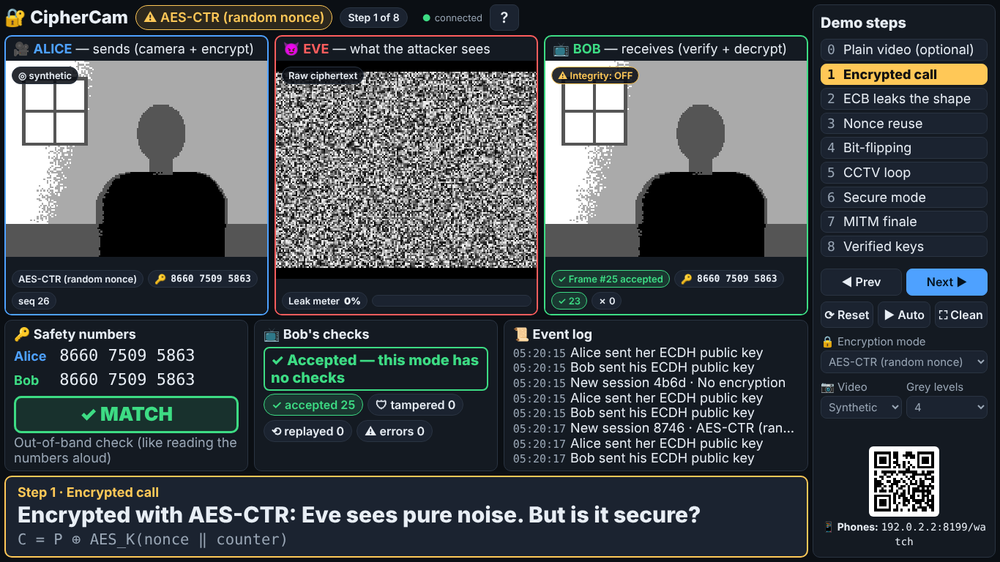

| Part of the screen | What it shows | ✅ Check |
|---|---|---|
| **Top bar** | 🔐 CipherCam · the current **mode** (here a yellow "⚠ AES-CTR (random nonce)") · "Step 1 of 8" · a green dot "● connected" · a **?** button | Green dot says **connected** |
| **Left panel, blue border: 🎥 ALICE** | What Alice films and sends. A grey room with a window and a dark person who sways and sometimes waves (this is the built-in "synthetic scene", a cartoon person used instead of a camera) | The person moves |
| **Middle panel, red border: 😈 EVE** | What the attacker sees travelling through the network. Under it: the **Leak meter** | Noise (like TV static), leak **0%** |
| **Right panel, green border: 📺 BOB** | What Bob receives and decrypts. A small badge says "Integrity: OFF" or "Integrity: ON" | Same picture as Alice |
| **🔑 Safety numbers** (bottom left) | The 12-digit numbers Alice and Bob each calculated from the keys | Both numbers equal and a green **✓ MATCH** |
| **📺 Bob's checks** (bottom middle) | Whether Bob accepted or rejected the last frames, and counters | Green "✓ Accepted", **accepted** keeps counting up |
| **📜 Event log** (bottom right) | What just happened (new keys, attacks, rejections) | Lines like "Alice sent her ECDH public key" |
| **Caption bar** (yellow border, very bottom) | The step's title, one sentence to say, and the formula | "Step 1 · Encrypted call" |
| **Demo steps** (right side) | Steps 0–8 (click one to jump to it), **◀ Prev / Next ▶**, **⟳ Reset**, **▶ Auto**, **⛶ Clean** | Step 1 is yellow |
| Under the steps | **🔒 Encryption mode** list, **📷 Video** list, **Grey levels** list, and a **QR code** for phones | Mode says "AES-CTR (random nonce)" |

❌ **Bob's panel stays black** for more than 3 seconds → click **⟳ Reset**.
❌ **The dot says "reconnecting…" in red** → the black window was closed. Double-click `start-demo.bat` again.
❌ **A red bar across the top** says "Open this page via http://localhost…" → you opened the page with a number address. Type `localhost:8080/stage` instead.

### The keyboard keys (click the Stage first!)

| Key | What it does |
|---|---|
| **→** | Next step |
| **←** | Previous step |
| **0** … **8** | Jump to that step |
| **R** | Reset: step 1, all attacks off, new keys |
| **A** | Auto-play the whole demo (press **A** again to stop) |
| **F** | Hide/show the side menu and top bar (clean projector view) |
| **?** | Show the list of keys (**Esc** closes it) |

---

## 6. The fastest full test: auto-play

👉 Click the caption bar, press **R**, then press **A** (or click **▶ Auto** in the side menu).

✅ A yellow **▶ AUTO-PLAY** badge appears at the top, and the demo plays **by itself** from step 0 to step 8 in about **2 minutes**, with the caption changing each time. Watch for these moments:

| Time | Step | ✅ You should see |
|---|---|---|
| 0:00 | 0 Plain video | Eve sees the same picture as Bob |
| 0:08 | 1 Encrypted call | Eve sees noise |
| 0:16 | 2 ECB | Eve sees the person's **outline in coloured blocks**, leak ~90% |
| 0:26 | 3 Nonce reuse | Eve sees the **real video** and "⚠ NONCE REUSED" |
| 0:36 | 4 Bit-flip | A **star** on Bob's video |
| 0:45 | 5 CCTV loop | "● REC … wave now!", the person leaves Alice's room, but **Bob still sees them** |
| 1:02 | 6 Secure mode | Red "⛔ TAMPERED FRAME REJECTED", later "⛔ REPLAY REJECTED" on Bob |
| 1:19 | 7 MITM | Eve sees the video ("EVE HAS THE KEY"), red **✗ MISMATCH** |
| 1:31 | 8 Verified keys | Green **✓ MATCH**, Eve back to noise |

✅ At the end, auto-play stops by itself and the badge disappears.
If all of this happened, **the whole application works**. Sections 7–8 let you test each part on purpose.

---

## 7. Test the five attacks, one by one

For each attack there are two ways:

- **Way 1 (easiest): one key on the Stage.** The Stage sets everything up for you.
- **Way 2 (by hand):** you choose the mode yourself and press Eve's buttons. For Way 2, open the Stage and Eve's panel **side by side** (see [section 4](#4-which-browser-tabs-to-open)).

Then each attack shows **the fix** and how to check it.

> Every time the mode changes, a **new call starts** with new keys. For about 1 second all panels show a **"CIPHERCAM / CONNECTING"** test card. That is normal. Wait 2–3 seconds before you judge what you see.

---

### Attack 1 — ECB pattern leak ("Eve sees your outline")

**The idea:** in ECB mode, identical pieces of the picture give identical encrypted pieces, so the shape shows through the encryption.

**Way 1:** 👉 click the Stage, press **2** (or click **2 ECB leaks the shape**).

**Way 2:** 👉 on the Stage, open the **🔒 Encryption mode** list and choose **AES-ECB**. 👉 In the Eve window, click the **Block colours** button.

✅ **You should see:**
- Top badge: **⚠ AES-ECB**.
- **Eve's panel turns into big coloured blocks**, and you can clearly recognise the **head, shoulders and the window**.
- **Leak meter about 90%**, with a red bar (in Way 1 the leak box also gets a yellow outline).
- Bob still shows the normal video (he has the key).

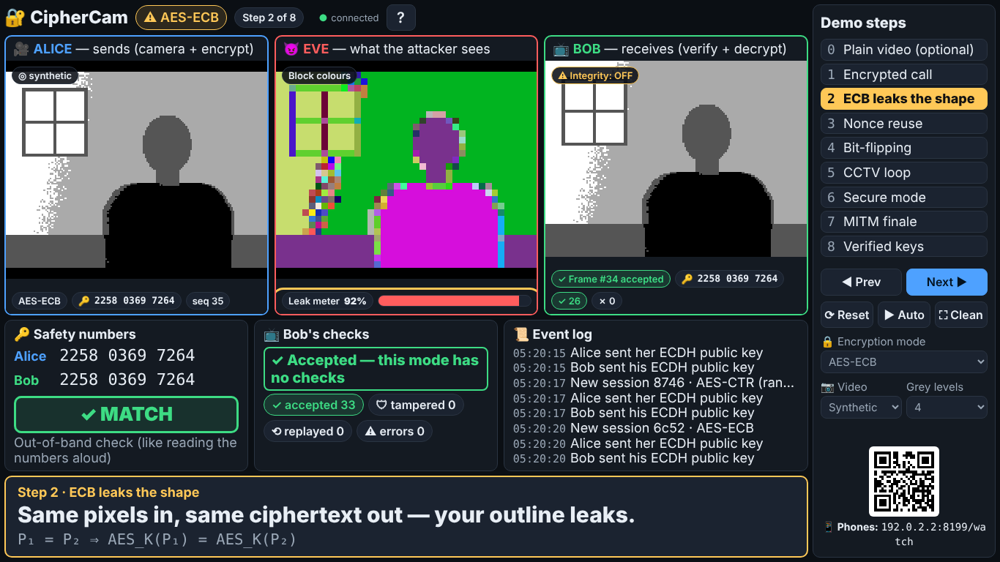

**The fix:** 👉 in **🔒 Encryption mode** choose **AES-CTR (random nonce)** (or **AES-CBC (random IV)**). Keep Eve on **Block colours**.
✅ Eve's panel becomes **random coloured confetti** with no shape, and the **leak meter drops to 0%**.

---

### Attack 2 — CTR nonce reuse ("Eve watches the call without the key")

**The idea:** if the same "nonce" (a number that must be used only once) is used for every frame, Eve can work out the secret keystream from the public "CONNECTING" screen and then decrypt everything.

**Way 1:** 👉 press **3**.

**Way 2:** 👉 in **🔒 Encryption mode** choose **AES-CTR — BUG: nonce reused**. 👉 In the Eve window click **Keystream recovery**.

✅ **You should see:**
- **Eve's panel shows the real video** (the grey room and the person), even though it is encrypted.
- A green badge **🔓 Keystream recovered: K = C₀ ⊕ splash**.
- A flashing yellow bar **⚠ NONCE REUSED (same IV as frame #0)**.

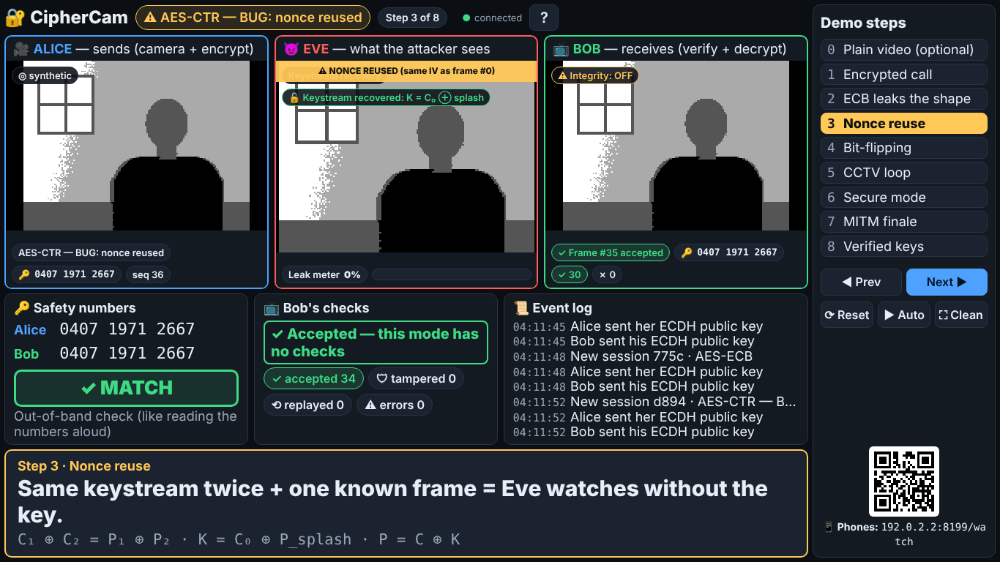

**Extra:** in the Eve window click **XOR with previous frame**. ✅ Eve's panel goes black except for **white outlines of the moving parts** (this works only because of the reused nonce).

**The fix:** 👉 choose **AES-CTR (random nonce)** in **🔒 Encryption mode**, and keep Eve on **Keystream recovery**.
✅ Eve's panel shows **noise** and the message **"No reuse detected — attack fails"**. The yellow warning is gone.

---

### Attack 3 — Bit-flipping ("Eve stamps a star on Bob's video")

**The idea:** in CTR mode, flipping bits in the encrypted data flips the same bits in the picture. Eve changes Bob's video without knowing the key.

**Way 1:** 👉 press **4**.

**Way 2:** 👉 choose **AES-CTR (random nonce)** in **🔒 Encryption mode**. 👉 In the Eve window, under **✏ Active: bit-flip stamp**, click **★ Star** (or **HACKED** or **☺ Smiley**). 👉 Click the red button **Bit-flip: OFF**. It changes to **Bit-flip: ON ✏**.

✅ **You should see:**
- Eve's own panel still shows noise (she can't read the video).
- **Bob's video has a big star** (or the word HACKED, or a smiley) stamped on it: parts of the picture turn inverted.
- Bob's checks still say **✓ Accepted — this mode has no checks**. Bob has no idea.
- The event log says **Eve bit-flips: ★ Star** in red.

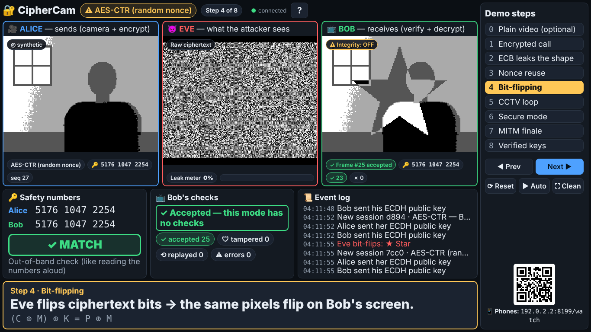

**The fix:** keep the bit-flip ON and 👉 choose **AES-GCM (secure)** in **🔒 Encryption mode**.
✅ A new call starts, and **no star ever appears on Bob's screen**: every frame is rejected, so Bob's panel stays dark ("New session — waiting for the first valid frame…"), a red bar says **⛔ TAMPERED FRAME REJECTED (tag mismatch)**, and the red **🛡 tampered** counter goes up quickly.
👉 Afterwards click **Bit-flip: ON ✏** in the Eve window to switch it **OFF**. ✅ Bob's video moves again.

---

### Attack 4 — Replay, the "CCTV loop" ("Bob sees someone who has left")

**The idea:** Eve records some perfectly valid encrypted frames and later plays them to Bob again and again, like a security-camera loop in a heist film.

**Way 1:** 👉 press **5**, then **just watch for about 10 seconds** (it runs by itself):
1. A big box counts down **"● REC 5 — wave now!"** … 1 while the person waves. Eve is recording.
2. **"The person leaves the room…"**: in Alice's panel the person walks out to the right.
3. **"⟲ Eve loops the old frames — Bob still sees the person"**.

**Way 2:** 👉 choose **AES-CTR (random nonce)**. 👉 In the Eve window, under **⟲ Active: replay**, leave **Seconds** at 5 and click **● Record**. The status says "● Recording…", then after 5 seconds "Recorded … s — press Loop". 👉 Tick **🚶 Person leaves the room (synthetic scene)**. 👉 Click **⟲ Loop**.

✅ **You should see:**
- **Alice's panel: an empty room.**
- **Bob's panel: the person, still there,** repeating the same few seconds over and over.
- Bob's checks say **✓ Accepted**. Bob is fooled.

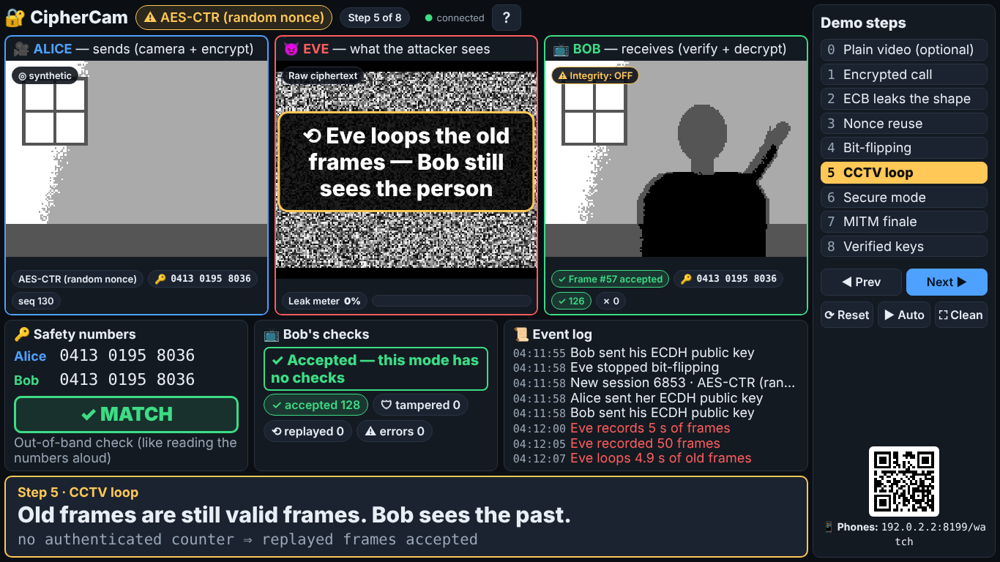

👉 To stop: click **■ Stop** in the Eve window (or press **R** on the Stage). Untick **🚶 Person leaves the room** so the person comes back.

**The fix:** 👉 choose **AES-GCM (secure)**. 👉 In the Eve window click **● Record**, wait 5 seconds, then click **⟲ Loop**.
✅ Bob's video **freezes** and a red bar says **⛔ REPLAY REJECTED (seq 37 ≤ last 212)** (the numbers vary). The red **⟲ replayed** counter goes up. Bob is never fooled. 👉 Click **■ Stop**: ✅ the live video continues.

---

### Attack 5 — Man-in-the-middle, MITM ("Eve swaps the keys")

**The idea:** when Alice and Bob agree on a key, Eve secretly swaps their public keys. Alice ends up sharing a key with Eve, and Bob shares a different key with Eve. Eve decrypts everything and re-encrypts it, so even AES-GCM can't help. Only comparing the **safety numbers** shows it.

**Way 1:** 👉 press **7**.

**Way 2:** 👉 choose **AES-GCM (secure)** (to prove even the secure mode falls). 👉 In the Eve window, under **🔀 Active: man-in-the-middle**, click **MITM: OFF**. It changes to **MITM: ON 🔀 (active in this session)**. (A new call with new keys starts automatically. That's the moment Eve swaps them.)

✅ **You should see:**
- Top badge: **🔒 AES-GCM (secure) · 🔀 MITM ACTIVE**.
- **Eve's panel shows the real video** with a red banner **🔓 EVE HAS THE KEY — she decrypts every frame**.
- **Bob still accepts every frame** (green "✓ Tag + counter verified — accepted"). The encryption "works".
- **🔑 Safety numbers: Alice's and Bob's numbers are different**, with a big red **✗ MISMATCH**. This is the only clue.

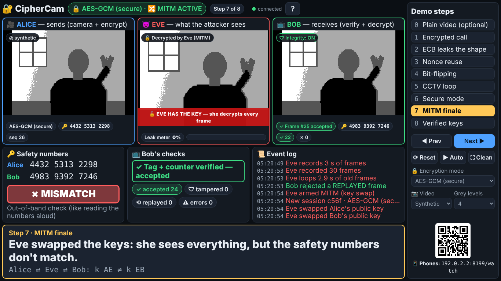

**The fix:** Alice and Bob compare their safety numbers (for example by reading them aloud). Different numbers = someone is in the middle, so they hang up.
👉 Press **8** (or click **MITM: ON** in the Eve window to turn it off).
✅ A new call starts, the two numbers are **identical** with a green **✓ MATCH**, and Eve sees **noise** again.

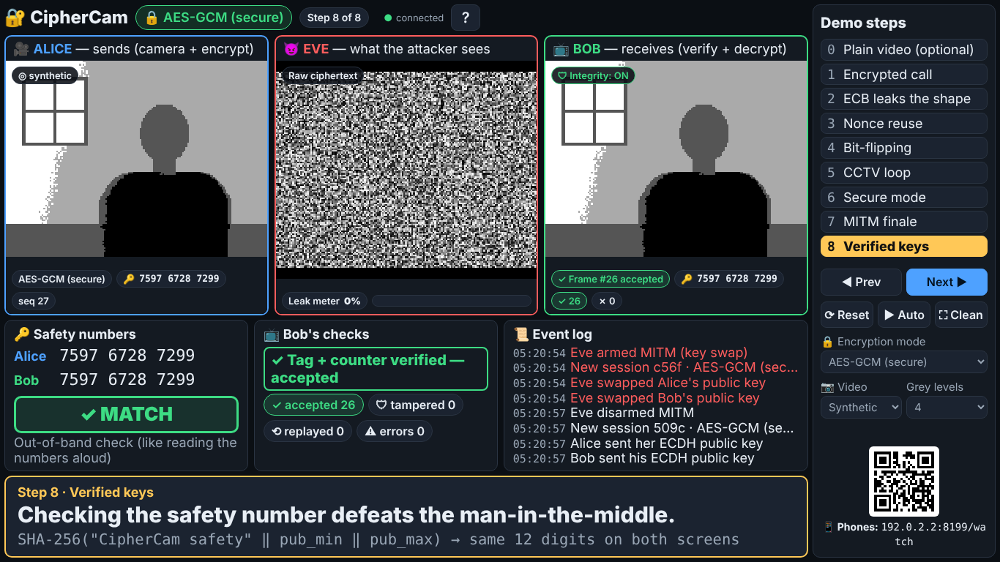

---

## 8. How to turn on secure mode

"Secure mode" means encryption **plus** tamper detection **plus** replay detection. CipherCam has two secure modes: **AES-GCM (secure)** (the main one) and **CTR + HMAC (Encrypt-then-MAC)**.

**Three ways to turn it on (pick any one):**

1. **Easiest:** on the Stage press **6** (or click **6 Secure mode**). The step even tries both attacks for you (see below).
2. **On the Stage side menu:** open **🔒 Encryption mode** and choose **AES-GCM (secure)** (or **CTR + HMAC (Encrypt-then-MAC)**).
3. **On Alice's own page** (`localhost:8080/alice`, see the warning in section 4): in the **Encryption mode** list choose **AES-GCM (secure)**.

✅ **How you can tell secure mode is on:**
- The top badge is **green** with a lock: **🔒 AES-GCM (secure)**.
- Bob's panel shows a green badge **🛡 Integrity: ON**.
- Bob's checks say **✓ Tag + counter verified — accepted**.
- Eve sees noise and the leak meter shows **0%**.

👉 **Prove that it works (step 6 does this automatically in ~15 seconds):**
1. After ~3 s a box says **"Eve tries the bit-flip…"** → ✅ Bob shows red **⛔ TAMPERED FRAME REJECTED (tag mismatch)**, his video freezes, **no star appears**, and **🛡 tampered** turns red and counts up.
2. After ~7 s **"Eve records 3 s of frames…"**, then **"Eve tries the replay…"** → ✅ Bob shows red **⛔ REPLAY REJECTED (seq … ≤ last …)** and **⟲ replayed** counts up.
3. Then the video moves normally again.

👉 You can repeat them with the red buttons that appear in the side menu during step 6: click **Try bit-flip**, wait 4 seconds, then click **Try replay**.

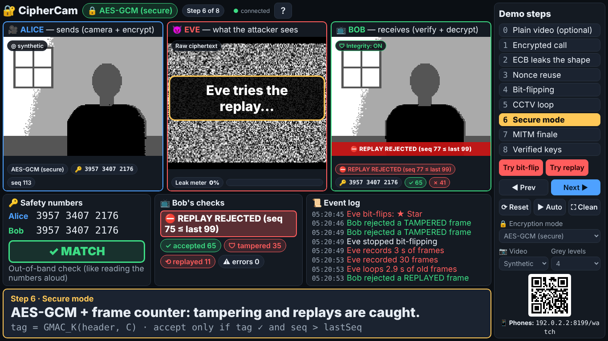

> **Remember:** secure mode stops tampering and replays, but **not** the man-in-the-middle (attack 5). For that you must compare the safety numbers.

---

## 9. Test with your webcam

The cartoon person is the safest choice for the classroom, but you should try your own camera once.

1. 👉 On the Stage side menu, open **📷 Video** and choose **Webcam**.
2. ✅ The browser asks **"localhost:8080 wants to use your camera"** → 👉 click **Allow**.
3. ✅ Within 2 seconds Alice's panel shows **you**, in four shades of grey, and the small badge says **📷 webcam**.
   ❌ A message says "Camera not available — switched to the synthetic scene": close every other program that uses the camera (Zoom, Teams, the Camera app) and choose **Webcam** again. Check that the laptop's camera privacy shutter is open.
4. 👉 Sit about **1 metre** from the laptop with a **plain wall behind you** and light **on your face**. Press **2** (ECB).
   ✅ In Eve's coloured blocks you can recognise **your head and shoulders**. The leak meter is above about 60%.
   ❌ It looks like confetti: set **Grey levels** (side menu) to **3**. You vanish into the wall: set it to **5**. A **dark shirt** helps a lot.
5. 👉 Press **→** to go through steps 3–8. ✅ Everything works the same with your face.
6. 👉 To go back to the cartoon person: **📷 Video → Synthetic scene**.

---

## 10. What each separate page should look like

You don't need these pages for the demo, but it is good to check them once. **Close the Stage tab first** (because of the "takes over" rule in section 4). Then open each address in a new tab.

### Start page — `localhost:8080/`

✅ A big **▶ Open Stage** button, six cards (Stage, Alice, Bob, Eve, Watch, Self-test) and a QR code for phones.

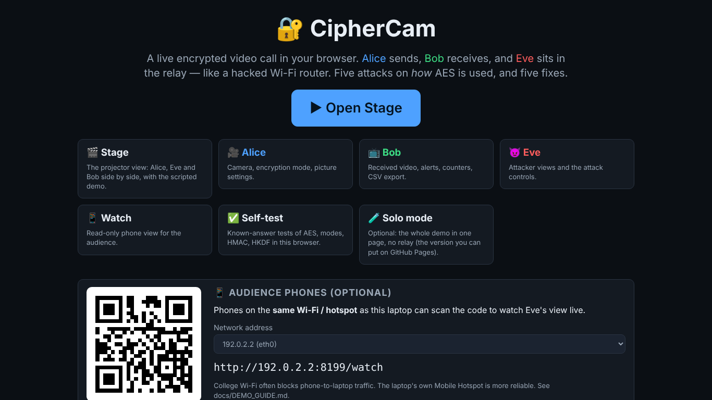

### Alice — `localhost:8080/alice`

✅ The video Alice sends, her safety number, and on the right: a status box ("🔒 Keys agreed — sending in …"), the **Encryption mode** and **Video source** lists, the **Person leaves the room** and **Keep waving** tick boxes, the **⟳ Restart session (new keys)** button, three sliders (**Grey levels**, **Frames per second**, **Flicker margin**), and **📷 Camera tuning tips**.
- If no Bob page is open, the video says **"Waiting for Bob…"**. That is correct. Open `/bob` in **another window** next to it (section 4 explains side-by-side windows).
- 👉 Click **⟳ Restart session (new keys)** → ✅ the safety number changes to a new one.

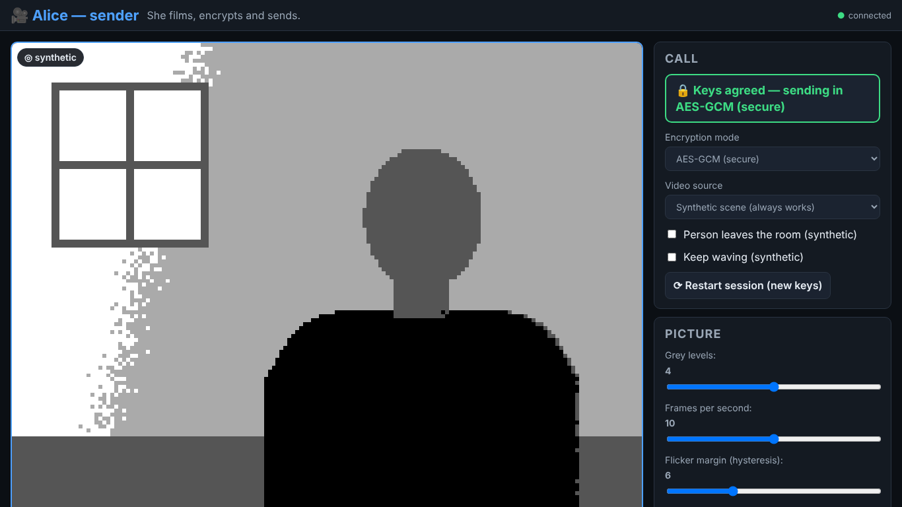

### Bob — `localhost:8080/bob`

✅ The received video, a **Last frame** box ("✓ Frame #… accepted"), the mode, **latency** and **fps** (about 10), four **Counters (this session)**: accepted, tampered, replayed, decrypt errors, and a **⬇ Download stats CSV** button.
- 👉 Click **⬇ Download stats CSV** → ✅ a `.csv` file downloads. It opens in Excel, one row per second.

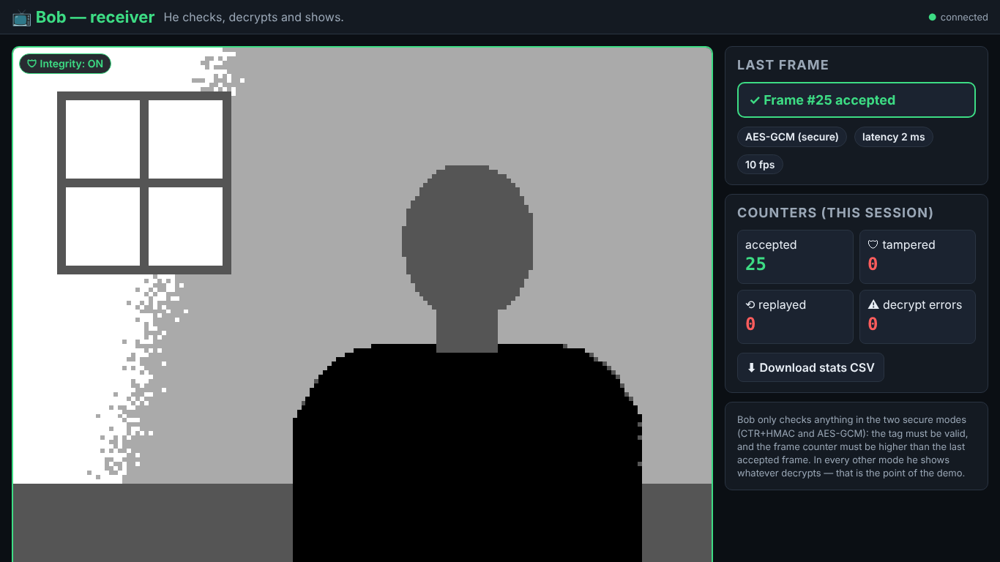

### Eve — `localhost:8080/eve`

✅ Eve's view, the **Leak meter**, the four view buttons (**Raw ciphertext**, **Block colours**, **XOR with previous frame**, **Keystream recovery**) with an explanation under them, and the three attack boxes: **bit-flip stamp** (with a black-and-white preview of the stamp), **replay** (**● Record**, **⟲ Loop**, **■ Stop**) and **man-in-the-middle** (**MITM: OFF/ON**).

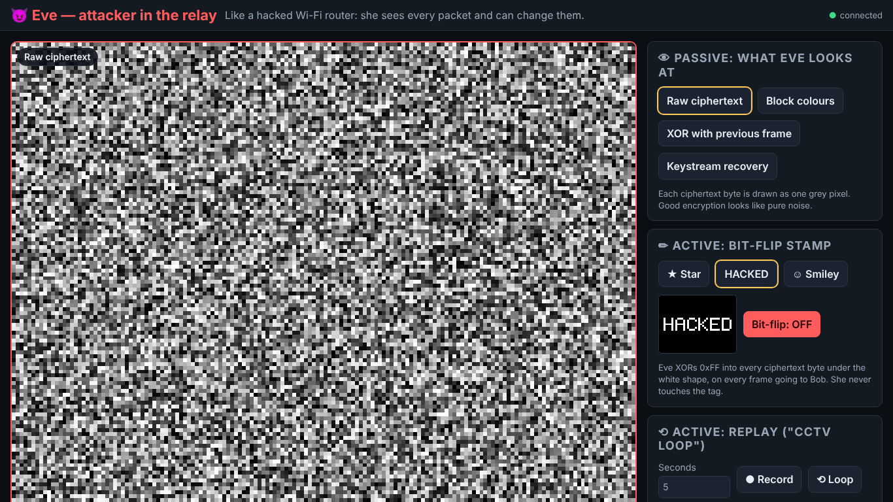

### Self-test — `localhost:8080/selftest`

✅ After a second: a green **✓ All 13 tests passed** and 13 rows that each say **✓ PASS** (AES, ECB, CBC, CTR, GCM, HMAC, HKDF, ECDH, safety number, …). This proves the encryption in **your** browser gives exactly the official answers.
❌ Any red **✗ FAIL**: update Chrome/Edge and try again.

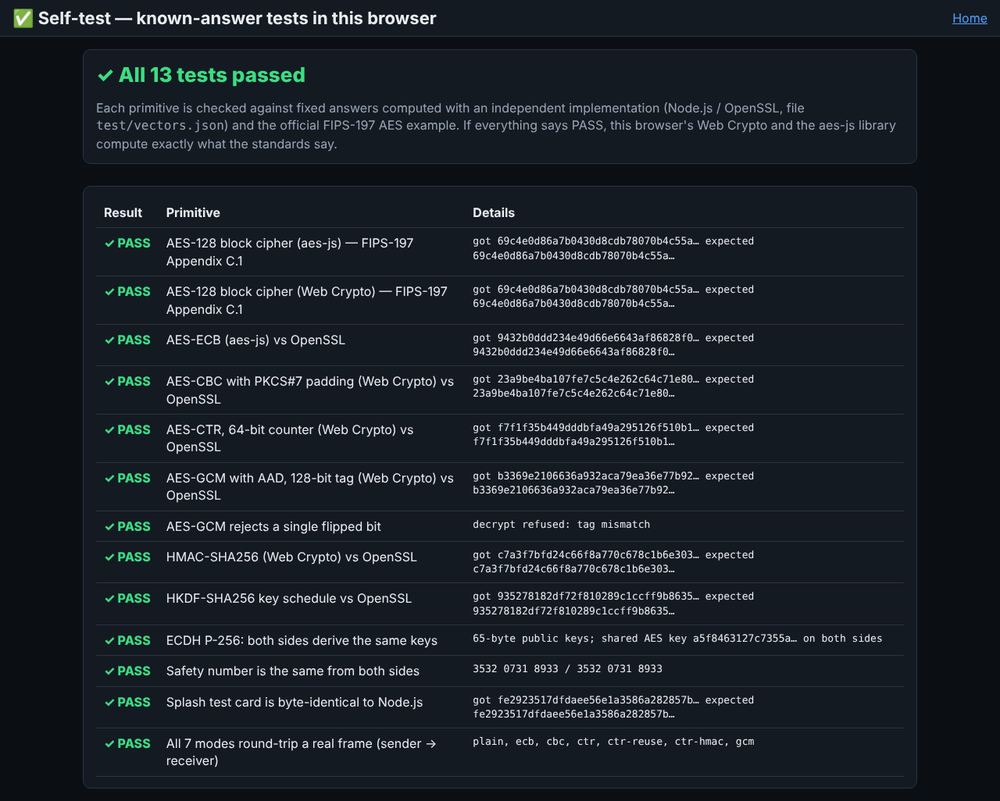

👉 When you're done, close these tabs and open `localhost:8080/stage` again.

---

## 11. Optional: phones and automatic tests

### Watch on a phone

1. 👉 Turn on the laptop's hotspot: **Settings → Network & internet → Mobile hotspot → On**. Connect your phone to that Wi-Fi. (Or connect the laptop and phone to the same phone hotspot.)
2. 👉 Scan the **QR code** in the Stage's side menu with the phone camera (or type the address shown under it, such as `192.168.137.1:8080/watch`, into the phone's browser).
3. ✅ The phone shows **"😈 What the attacker sees"**, the current step and caption, and Eve's picture, updating a few times a second. Change steps on the laptop: the phone follows.
   ❌ It doesn't load: allow Node.js through the firewall (section 12). College Wi-Fi usually blocks this, so use a hotspot. The demo itself doesn't need phones.

### Automatic tests (the computer checks everything itself)

1. 👉 Open the CipherCam folder in File Explorer. Click the **address bar at the top of the folder window** (where the folder path is), type `cmd`, press **Enter**. A Command Prompt opens **already inside the CipherCam folder**.
2. 👉 Type `npm test` and press **Enter**. Wait about 15 seconds.
   ✅ Near the end: **`# pass 48`** and **`# fail 0`**.
3. 👉 (Optional, needs internet the first time.) Type `npx playwright install chromium`, press **Enter** and wait for the download. Then type `npm run e2e`, press **Enter** and **don't touch anything for about 5 minutes**.
   ✅ The last line says **`… passed`** and nothing says **failed**.
4. 👉 Type `npm run bench` and press **Enter**.
   ✅ One line per mode, ending with "Wrote docs/results/bench.csv and docs/results/RESULTS.md".

---

## 12. Troubleshooting

### The black window / starting

| What you see | What to do |
|---|---|
| "Node.js was not found on this computer" | Do [section 1](#1-install-nodejs-once), then restart the laptop. |
| "Windows protected your PC" | Click **More info** → **Run anyway**. |
| The black window flashes and closes | Open a Command Prompt in the folder (section 11, step 1), type `start-demo.bat`, press Enter, and read the message. |
| "npm install failed" | The first start needs internet. Connect to Wi-Fi and double-click `start-demo.bat` again. |
| "Ports 8080-8090 all seem busy" | Another CipherCam is already running (maybe a hidden black window). Close all black windows, or restart the laptop. |
| The browser didn't open | Open Chrome/Edge and type `localhost:8080/stage`. |

### The Stage

| What you see | What to do |
|---|---|
| The keys do nothing | Click once on the yellow caption bar at the bottom, then press the key again. |
| Bob's panel is black | Wait 3 seconds. Then press **R**. |
| A panel is frozen or white | Press **R**. Still stuck: **right-click inside that panel → Reload frame**. Still stuck: press **F5**. |
| A panel says "Another Alice/Bob page took over" | You opened `/alice` or `/bob` somewhere else. Close that tab, then click the message (or press **F5**). |
| Red dot "reconnecting…" | The black window was closed. Double-click `start-demo.bat` again; the page reconnects by itself. |
| A red bar "Open this page via http://localhost…" | Use the address `localhost:8080/stage`, not a number address and not a file. |
| The video is slow / jerky | Close other programs and tabs. Don't hide the Stage behind another window. Plug in the charger. |
| Everything is frozen | Click the black window, press **Ctrl + C** (it says "Stopping CipherCam…"), double-click `start-demo.bat` again, then press **F5** in the browser. |

### The attacks

| What you see | What to do |
|---|---|
| Step 2: no outline in Eve's panel | Check Eve's badge says **Block colours** (press **2** again). With a webcam: Grey levels **3**, plain wall, dark shirt. |
| Step 3: Eve shows noise, "No reuse detected" | The mode must be **AES-CTR — BUG: nonce reused**. Press **3** again. |
| Step 4: no star on Bob | The mode must be a non-secure one such as AES-CTR (in GCM the star is rejected — that's the fix!). Press **4** again. |
| Step 5: Bob doesn't show the person after they leave | Wait for the "⟲ Eve loops" message (about 9 seconds after pressing 5). Press **5** again and don't press other keys. |
| Step 6: no red alerts | Wait 15 seconds, or click **Try bit-flip**, wait, then **Try replay**. |
| Step 7: numbers still match | Wait 3 seconds (new keys). Press **7** again. |
| Nothing at all works | Plan B: open `docs/backup-demo.mp4` (double-click it). It is a recording of the full demo. |

### The webcam

| What you see | What to do |
|---|---|
| "Camera not available" | Close Zoom/Teams/Camera. Check the privacy shutter and Windows **Settings → Privacy & security → Camera** (camera access ON, browser allowed). Choose **📷 Video → Webcam** again. |
| The browser never asked for the camera | Click the 🔒 or camera icon at the left of the address bar → set **Camera: Allow** → press **F5**. |
| The camera works but the ECB outline is unclear | See [section 9](#9-test-with-your-webcam), step 4. |

### Stopping

👉 Click the black window and press **Ctrl + C**, or simply close the black window. The browser pages then say "reconnecting…", which is normal. To start again, double-click `start-demo.bat`.

---

## 13. My test checklist

**Start**
- [ ] `node -v` shows a version number (section 1)
- [ ] The black window says **CipherCam is running** (section 3)
- [ ] The Stage opens; green **● connected**; Alice and Bob show video; Eve shows noise; **✓ MATCH** (section 5)
- [ ] Auto-play (**A**) runs all steps 0–8 by itself (section 6)

**The five attacks** (section 7)
- [ ] 1 ECB: outline visible in Eve's blocks, leak ~90% → fix: CTR, leak 0%
- [ ] 2 Nonce reuse: Eve sees the real video + "⚠ NONCE REUSED" → fix: "No reuse detected — attack fails"
- [ ] 3 Bit-flip: star on Bob's video → fix (GCM): "TAMPERED FRAME REJECTED", no star
- [ ] 4 Replay: Alice's room empty, Bob still sees the person → fix (GCM): "REPLAY REJECTED"
- [ ] 5 MITM: "EVE HAS THE KEY" + ✗ MISMATCH → fix: step 8, ✓ MATCH

**Secure mode** (section 8)
- [ ] Green **🔒 AES-GCM (secure)** badge and **🛡 Integrity: ON**
- [ ] **Try bit-flip** → tampered counter rises; **Try replay** → replayed counter rises

**Extras**
- [ ] Webcam: my outline appears in step 2 (section 9)
- [ ] Keys **R**, **F**, **?**, **←**, **→** work (section 5)
- [ ] `/selftest`: ✓ All 13 tests passed (section 10)
- [ ] (optional) `npm test`: `# fail 0` (section 11)
