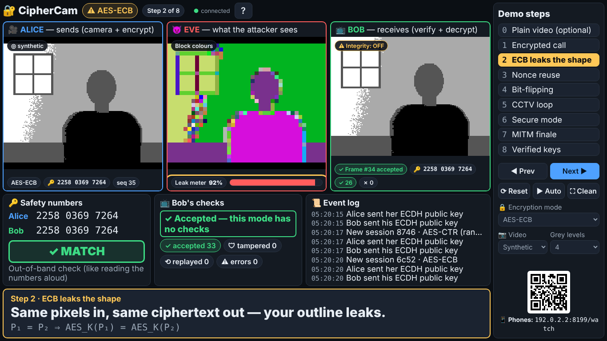
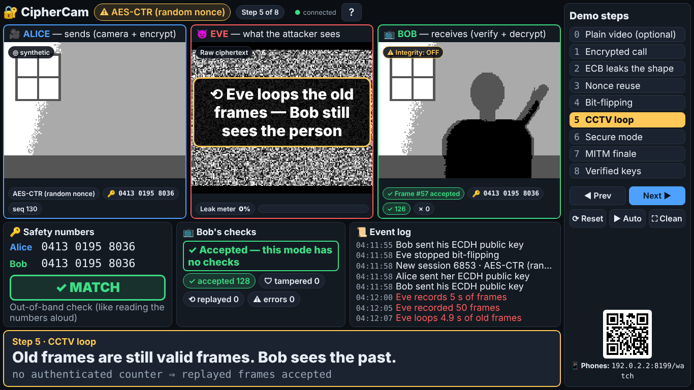
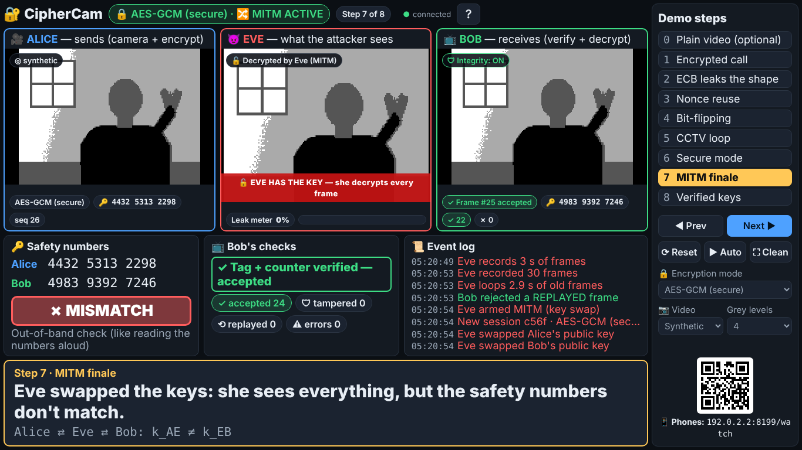

# CipherCam: An Interactive Attack Lab for Misused Block-Cipher Modes, Message Authentication, Replay and Key-Exchange Authentication

**Course:** EC 425 Cryptography and Network Security
**Student:** Aravapalli Sai Chaithr Choudary (23ECB0A20), B.Tech ECE, NIT Warangal
**Instructor:** Dr. Sourabh Solanki

*(Draft. Numbers in Section 6 come from `docs/results/` and the screenshots from `docs/screenshots/`; regenerate them with `npm run bench`, `npm run e2e` and `npm run soak` before submitting.)*

---

## Abstract

CipherCam is a live, browser-based encrypted video call that demonstrates five classic failures in the *use* of cryptography and their standard fixes. Alice streams 160×120 grayscale video at 10 frames per second through a Node.js WebSocket relay to Bob; Eve, an attacker inside the relay, performs passive and active attacks. Using only standard primitives from the browser's Web Crypto API (AES-CBC, AES-CTR, AES-GCM, HMAC-SHA256, ECDH P-256, HKDF), plus the `aes-js` library for AES-ECB, the system shows that (1) ECB leaks the outline of a person (89.6 % of ciphertext blocks repeat), (2) a reused CTR nonce lets Eve recover the keystream from a public "Connecting…" test card and watch the call, (3) bit-flipping stamps an attacker-chosen shape onto Bob's video, (4) replayed frames make Bob see a person who has left the room, and (5) a man-in-the-middle on an unauthenticated ECDH exchange defeats even AES-GCM. The fixes (randomized modes, unique nonces, AEAD/HMAC, an authenticated frame counter and safety-number comparison) reject 100 % of tampered and replayed frames and expose the MITM, at a cost of 28 bytes and about 0.1 ms per frame. AES itself is never broken. The implementation is verified against OpenSSL and the FIPS-197 test vector, with 54 automated unit/integration tests (including an independent OpenSSL re-implementation of the receiver and of every attack) and an end-to-end browser test of every demo step.

## 1. Introduction and motivation

Students usually meet AES as an unbreakable black box. In practice, most real-world cryptographic failures come not from breaking the cipher but from misusing it: choosing ECB, repeating nonces, encrypting without authenticating, forgetting freshness, or trusting an unauthenticated key. These mistakes are easy to describe on a slide but hard to *feel*.

CipherCam makes each mistake visible in real time. Because the data is video, the consequences are immediate and intuitive: a silhouette appearing in "encrypted" noise, a star appearing on the receiver's screen, a person who is still waving after they left. Each attack is followed by its fix, so the audience sees both the failure and the correct engineering practice.

**Objectives.**

1. Build a working encrypted video call in the browser using standard primitives only.
2. Demonstrate five attacks live: ECB pattern leak, CTR nonce reuse, bit-flipping, replay, key-exchange MITM.
3. Demonstrate the standard countermeasure for each and measure its cost.
4. Verify correctness against independent implementations and make the demo reproducible and robust for a classroom.

## 2. Background and syllabus mapping

| Syllabus unit | Topic | Where it appears in CipherCam |
|---|---|---|
| Unit 1 | Security attacks (passive/active), security services (confidentiality, integrity, authentication) | Eve's passive views (ECB, keystream recovery) vs. active attacks (bit-flip, replay, MITM); each fix mapped to a service |
| Unit 2 | AES, block cipher modes (ECB, CBC, CTR, GCM), IVs and nonces | Seven modes, including a deliberately buggy `ctr-reuse`; 4×4-tile layout makes one AES block one image patch |
| Unit 3 | Public-key cryptography, Diffie-Hellman / ECDH | Per-session ECDH P-256 key exchange, HKDF key derivation, MITM key substitution |
| Unit 4 | MACs, HMAC, authenticated encryption, replay protection, entity authentication | Encrypt-then-MAC with HMAC-SHA256, AES-GCM AEAD, authenticated sequence numbers, safety numbers |

Course outcomes (adapt the wording to the official CO statements):

- **CO1 — Identify threats and security services:** the five attacks are classified as passive or active, and each is mapped to the security service that fails (confidentiality, integrity, freshness, entity authentication).
- **CO2 — Apply symmetric and public-key algorithms:** AES in five modes, ECDH P-256, HKDF-SHA256, cross-checked against OpenSSL and FIPS-197.
- **CO3 — Analyse authentication, integrity and key-management mechanisms:** HMAC vs. GCM, encrypt-then-MAC ordering, replay windows, and why AEAD does not solve key authentication.

Key references for the primitives: AES (FIPS-197), block-cipher modes (NIST SP 800-38A), GCM (NIST SP 800-38D), HMAC (RFC 2104), HKDF (RFC 5869). Concepts are explained in plain language in `docs/EXPLAINED.md`.

## 3. Threat model

- **Alice** and **Bob** run on the presenter's laptop and are honest.
- **Eve** controls the relay ("the network"), like a compromised Wi-Fi router. She can read every message (passive), and modify, drop, record, replay and inject messages (active), including the key-exchange messages.
- Eve does **not** know any private key or session key and cannot break AES, SHA-256 or P-256.
- Alice and Bob share an **out-of-band channel** Eve cannot touch (reading numbers aloud; simulated with a same-origin `BroadcastChannel`).

## 4. Design

### 4.1 Architecture

```
 Alice page ──WS──►  RELAY SERVER (Node) = "the network"  ──WS──►  Bob page
 (camera, encrypt)    Eve's ACTIVE attacks: bit-flip, replay, MITM   (verify, decrypt)
                          │ copies of every frame
                          ▼
              Eve page / Stage / audience phones
              (PASSIVE analysis: raw bytes, ECB block colours, XOR, keystream recovery)
```

All sender and receiver logic lives in `shared/` and runs unchanged in the browser and in Node, so the whole Alice → Eve → Bob pipeline, including every attack, is testable without a browser. Full diagrams: `docs/ARCHITECTURE.md`.

### 4.2 Video pipeline

Frames are captured at 640×480, area-averaged in 4×4 groups to 160×120 luma, smoothed with an exponential moving average (`0.6·old + 0.4·new`), and posterized to 4 levels with hysteresis (margin 6) to suppress flicker. The frame is serialized in **4×4 tiles**, so each 16-byte AES block is one square patch of the image (1,200 blocks, 19,200 bytes). Posterization is what makes equal plaintext blocks common enough to show the ECB leak with a real, noisy webcam. Every session begins with 10 frames of a deterministic test card (`CIPHERCAM / CONNECTING`), rendered from integer maths and a hard-coded bitmap font so that it is byte-identical everywhere; this is the known plaintext used in the nonce-reuse attack.

### 4.3 Key establishment

Each session: fresh ECDH P-256 key pairs; `hello` messages carry the 65-byte raw public keys; `shared = ECDH(priv, peerPub)`; `okm = HKDF-SHA256(shared, salt = SHA-256(sid), info = "CipherCam v1 keys", 52 bytes)` split into `aesKey (16) | macKey (32) | nonceSalt (4)`. The **safety number** is the first 6 bytes of `SHA-256("CipherCam safety" ‖ min(pubA, pubB) ‖ max(pubA, pubB))` shown as 12 digits; it is identical on both sides unless the keys were substituted.

### 4.4 Modes

| Mode | Construction | Receiver checks |
|---|---|---|
| `plain` | none | none |
| `ecb` | AES-ECB per block (aes-js) | none |
| `cbc` | AES-CBC, random 16-byte IV, PKCS#7 | none |
| `ctr` | AES-CTR, random 16-byte counter block per frame | none |
| `ctr-reuse` | AES-CTR, the same counter block for the whole session (bug) | none |
| `ctr-hmac` | AES-CTR then HMAC-SHA256(macKey, header ‖ ciphertext) | tag, then `seq > lastSeq` |
| `gcm` | AES-GCM, nonce = nonceSalt ‖ seq (96 bits), AAD = header | tag, then `seq > lastSeq` |

The frame header (`sid, seq, mode, iv, w, h, levels, ts`) is sent as UTF-8 JSON; its exact bytes are authenticated in the two secure modes, so the sequence number cannot be altered.

### 4.5 Attacks

- **ECB leak (passive):** Eve colours each ciphertext block by its first three bytes; equal blocks get equal colours. A *leak meter* reports the fraction of duplicate blocks per frame.
- **Nonce reuse (passive, known plaintext):** Eve detects a repeated IV, computes `K = C₀ ⊕ P_splash`, and displays `C ⊕ K` for every later frame.
- **Bit-flipping (active):** the relay XORs a star/HACKED/smiley mask into the ciphertext (never the tag) on the way to Bob: `(C ⊕ M) ⊕ K = P ⊕ M`.
- **Replay (active):** the relay records N seconds of valid frames with their timing, then blocks live video and loops the recording.
- **MITM (active):** the relay substitutes its own public keys in both `hello` messages, derives `k_AE` and `k_EB`, decrypts each frame with the shared receiver code, and re-encrypts it with the same mode and `seq` using the shared sender code.

## 5. Implementation

- **Stack:** Node.js 20+ (ES modules), `ws` WebSocket server, vanilla HTML/CSS/JS (no framework, no build step), Web Crypto for all primitives except ECB (`aes-js` 3.1.2). Fully offline after installation.
- **Pages:** `/stage` (projector view with three embedded panels, scripted demo steps, captions, keyboard shortcuts and the mode / video-source / grey-level controls), `/alice`, `/bob`, `/eve`, `/watch` (read-only phone view that needs no Web Crypto, so it works over plain HTTP on the LAN), `/selftest`, and an optional `/solo` page that runs Alice, the relay with Eve's attacks, and Bob in one page (also buildable as a static site for GitHub Pages or Vercel).
- **Demo automation:** nine steps defined once in `shared/steps.js`; each sets the complete configuration and restarts the session, so any step is reachable from any other without leftover state. Auto-play (`A`) runs the whole demo with captions.
- **Robustness:** auto-reconnecting WebSockets, one Alice/one Bob with clean replacement, session restarts under 1 s, frame dropping for slow clients, watcher cap and throttling, control accepted from localhost only.
- **Code size:** about 4,100 lines of application code (server, shared modules, pages, styles; including comments); every cryptographic line is commented in plain English.

## 6. Attack lab results

### 6.1 Correctness

- `npm test`: **54 tests pass**, including byte-for-byte equality with OpenSSL (`node:crypto`) for ECB, CBC, CTR, GCM, HMAC-SHA256 and HKDF, ECDH agreement with an independent ECDH implementation, and the FIPS-197 Appendix C.1 vector (`69c4e0d86a7b0430d8cdb78070b4c55a`).
- **Independent end-to-end check** (`test/independent.test.js`): Bob, Eve's analysis, ECDH, HKDF, all AES modes, HMAC and the safety number are re-implemented with OpenSSL only and run against the application's real sender through the real relay. Every frame on the wire is byte-identical to OpenSSL's output in all seven modes; each attack has exactly the predicted effect on the bytes (ECB equal blocks, exact keystream recovery, `P ⊕ M` after bit-flipping, accepted replays in CTR, valid-tag-but-old-counter rejections in GCM/CTR+HMAC, accepted MITM frames with mismatching safety numbers); and the application's receiver agrees with the OpenSSL receiver on every frame.
- `/selftest`: **13/13 known-answer tests pass** in Chromium, including that the browser's splash frame is byte-identical to Node's.
- `npm run e2e`: Playwright drives the Stage through all nine steps at 1366×768 and 1920×1080 and asserts each step's claim (e.g. leak > 50 % for ECB, keystream "recovered" for nonce reuse, tamper and replay counters rising in GCM, safety numbers mismatching under MITM), that Alice, Eve and Bob are in the same fresh session with a new safety number at every step, and that no element of the Stage overlaps another or is cut off at either resolution.

### 6.2 Measurements (`npm run bench`, 1,000 frames per mode, Node.js 22, Intel Xeon 2.1 GHz)

| Mode | Encrypt ms/frame | Decrypt ms/frame | Overhead B/frame | Leak meter | Bit-flipped frames rejected | Replayed frames rejected |
|---|---:|---:|---:|---:|---:|---:|
| plain | 0.05 | 0.05 | 0 | 89.6 % | 0 % | 0 % |
| ecb | 0.79 | 0.77 | 0 | 89.6 % | 0 % | 0 % |
| cbc | 0.29 | 0.17 | 32 | 0.0 % | 0 % | 0 % |
| ctr | 0.19 | 0.19 | 16 | 0.0 % | 0 % | 0 % |
| ctr-reuse | 0.15 | 0.18 | 16 | 0.0 % | 0 % | 0 % |
| ctr-hmac | 0.22 | 0.16 | 48 | 0.0 % | **100 %** | **100 %** |
| gcm | 0.10 | 0.11 | 28 | 0.0 % | **100 %** | **100 %** |

MITM in GCM: Bob accepted **100/100** re-encrypted frames; the safety numbers differed (e.g. `2929 4654 3764` vs `0690 8823 8149`).

In the browser, with all three Stage panels open in headless Chromium, Bob sustained **10.0 fps** in AES-GCM with about 4 ms end-to-end latency (`docs/results/e2e-fps.json`). In a **10-minute auto-play soak test** (`docs/results/SOAK.md`) there were **0 console errors**, Bob never accepted fewer than 220 frames in any 30-second window, and memory stayed flat (browser heap 6.0 → 5.5 MB, server heap 43.7 → 44.1 MB).

### 6.3 Discussion

1. **ECB leaks; randomized modes don't.** ECB's leak meter equals that of no encryption (89.6 %), and the person's outline is clearly visible in Eve's block-colour view (Figure 2). Every randomized mode measures 0 %.
2. **The leak meter cannot see nonce reuse.** Within one frame the reused keystream is still pseudorandom (0 %); the failure is *between* frames. With one known plaintext frame, Eve reconstructs the live video exactly (Figure 3). The unit tests confirm `C₁ ⊕ C₂ = P₁ ⊕ P₂` and exact keystream recovery.
3. **Encryption ≠ integrity.** Without a MAC, 0 % of tampered frames are rejected; CTR delivers exactly `P ⊕ M` (Figure 4). CBC garbles the stamped blocks but still accepts them.
4. **Integrity ≠ freshness.** Replayed CTR frames are all accepted (Figure 5). Only an authenticated counter rejects them.
5. **Security is cheap.** AES-GCM adds 28 bytes (0.15 %) and was the fastest mode measured; the whole budget at 10 fps is 100 ms per frame.
6. **AEAD does not authenticate the peer.** Under MITM every GCM tag verifies; only comparing safety numbers reveals Eve (Figure 7).

### 6.4 Figures

- Figure 1 — Step 1, AES-CTR: Eve sees noise. `docs/screenshots/step-1-1366.png`
- Figure 2 — Step 2, ECB: silhouette visible, leak 92 %. `docs/screenshots/step-2-1366.png`
- Figure 3 — Step 3, nonce reuse: Eve watches the call. `docs/screenshots/step-3-1366.png`
- Figure 4 — Step 4, bit-flip: star on Bob's video. `docs/screenshots/step-4-1366.png`
- Figure 5 — Step 5, CCTV loop: empty room at Alice, person at Bob. `docs/screenshots/step-5-1366.png`
- Figure 6 — Step 6, AES-GCM: tampered and replayed frames rejected. `docs/screenshots/step-6-1366.png`
- Figure 7 — Step 7, MITM: "EVE HAS THE KEY", safety numbers ✗ MISMATCH. `docs/screenshots/step-7-1366.png`
- Figure 8 — Step 8, verified keys: ✓ MATCH. `docs/screenshots/step-8-1366.png`





## 7. Limitations

- The video is deliberately small (160×120, 4 grey levels) so that the ECB leak is visible on a projector; real codecs compress before encrypting, which changes the leak's appearance but not the principle.
- Eve is a process on the same laptop; there is no real network adversary, NAT traversal or packet loss. The strict `seq > lastSeq` rule would need a sliding window over an unordered transport (as in IPsec/DTLS).
- The out-of-band channel is simulated with a `BroadcastChannel`; real systems compare fingerprints by voice, QR code or in person.
- No long-term identity keys, certificates or audio. Safety numbers are 12 digits (~40 bits). Against the demo's Eve (random keys) a false match has probability 10⁻¹², but because Eve chooses both substituted keys after seeing the real ones, a determined attacker could search for a colliding pair with about 2²⁰ trials per side; deployed systems prevent this with a hash commitment to the public key (ZRTP) or long-term identity keys and 60-digit numbers (Signal).
- A real webcam must be tuned on the presenter's laptop (lighting, background, grey levels); the cloud test environment uses a synthetic scene and Chromium's fake camera.

## 8. Conclusion

CipherCam shows, live and measurably, that the security of an encrypted channel depends on the whole construction: a randomized mode with unique nonces for confidentiality, a MAC or AEAD for integrity, an authenticated counter for freshness, and authenticated key exchange for knowing *who* holds the key. Each property is cheap to add and, in our measurements, eliminates its attack completely, while the absence of any one of them is enough for an attacker to see, alter, replay or intercept the call without ever breaking AES.

## References

1. NIST, *FIPS 197: Advanced Encryption Standard (AES)*, 2001 (updated 2023).
2. M. Dworkin, *NIST SP 800-38A: Recommendation for Block Cipher Modes of Operation — Methods and Techniques*, 2001.
3. M. Dworkin, *NIST SP 800-38D: Recommendation for Block Cipher Modes of Operation — Galois/Counter Mode (GCM) and GMAC*, 2007.
4. H. Krawczyk, M. Bellare, R. Canetti, *RFC 2104: HMAC — Keyed-Hashing for Message Authentication*, 1997.
5. H. Krawczyk, P. Eronen, *RFC 5869: HMAC-based Extract-and-Expand Key Derivation Function (HKDF)*, 2010.
6. W. Stallings, *Cryptography and Network Security: Principles and Practice*, 8th ed., Pearson.
7. M. Bellare, C. Namprempre, "Authenticated Encryption: Relations among Notions and Analysis of the Generic Composition Paradigm", ASIACRYPT 2000.
8. W3C, *Web Cryptography API* (Recommendation).
